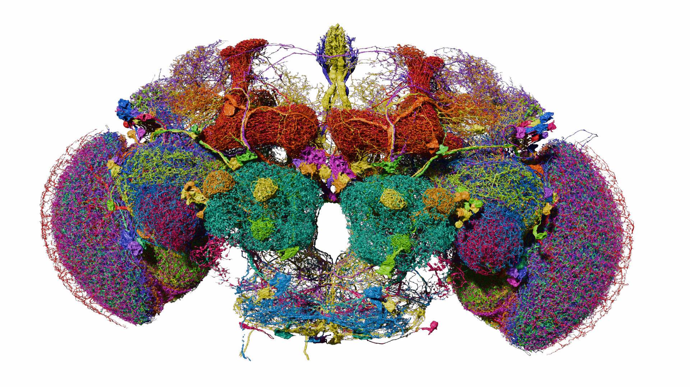

# 00. 이 책을 읽기 전에

## 초파리 뇌가 왜 중요한가

초파리의 뇌는 아주 작습니다. 그런데 작은 크기와 단순한 생김새가 곧 단순한 행동을 뜻하지는 않습니다. 초파리는 빛과 냄새를 구분하고, 걷고 날며, 먹이를 찾고, 위험을 피하고, 보상 경험에 따라 행동을 바꿉니다.

이 책은 “초파리가 사람처럼 생각한다”는 이야기를 하려는 책이 아닙니다. 대신 아주 작은 뇌에서도 감각 입력이 신경 회로를 거쳐 행동으로 이어지는 과정을 어떻게 연구하는지 살펴봅니다.

그림 00. 큰 뉴런 50개의 실제 데이터 렌더링. 전체 뇌가 아니라 선택한 부분집합이다. 데이터: FlyWire.ai. 렌더링: Philipp Schlegel (University of Cambridge/MRC LMB). [원본 갤러리](https://flyconnecto.me/media/) · [CC BY 4.0](https://creativecommons.org/licenses/by/4.0/). 제공된 1920×1080 파일을 수정 없이 수록.

## 커넥톰은 뇌의 지도다

커넥톰(connectome)은 뇌 속 뉴런과 뉴런 사이의 연결을 지도처럼 기록한 것입니다. 도로 지도가 도시의 모든 교통 흐름을 자동으로 설명하지 않듯, 커넥톰도 연결 구조만으로 기억·의식·행동을 완전히 설명하지는 못합니다.

| 구분 | 쉬운 비유 | 알 수 있는 것 | 아직 알기 어려운 것 |
|---|---|---|---|
| 커넥톰 | 도로 지도 | 어떤 뉴런이 연결됐는가 | 실제 순간의 활동과 주관적 경험 |
| 신경 활동 기록 | 교통량 측정 | 언제 어느 회로가 작동하는가 | 모든 연결의 전체 구조 |
| 행동 실험 | 실제 차량 운행 | 자극에 어떤 행동을 하는가 | 내부 회로의 모든 원인 |
| 시뮬레이션 | 컴퓨터 도시 모델 | 가설을 반복해서 시험하기 | 모델이 실제 생물과 같은가 |

## 이 책의 읽는 법

본문에서는 숫자와 용어를 가능한 한 일상적인 말로 풀어 씁니다. 연구 논문이나 공식 데이터가 말하는 사실과, 저자가 이해를 돕기 위해 덧붙인 비유를 분리해서 표시합니다.

실제 연구 이미지를 사용할 때는 이미지 아래에 출처와 이용 조건을 적습니다. 생성한 설명 도식은 “생성 도식”이라고 표시합니다.

> **핵심 문장**
>
> 초파리 뇌의 지도를 얻었다는 것은 뇌의 모든 비밀을 푼 것이 아니라, 질문을 더 정확하게 할 수 있는 공통 지도를 얻었다는 뜻입니다.

## 독자가 가져갈 세 가지 능력

첫째는 뉴런, 연결, 활동을 서로 다른 말로 설명하는 능력입니다. 처음에는 모두 “뇌가 움직이는 것”처럼 느껴질 수 있습니다. 하지만 무엇을 측정했는지 구분하면 뉴스의 문장이 훨씬 명확해집니다.

둘째는 그림을 읽는 능력입니다. 이 책에는 실제 연구 자료를 시각화한 그림과 저자가 만든 설명 도식이 함께 있습니다. 실제 그림도 전자현미경 사진인지, 재구성한 형태를 색으로 구분한 렌더링인지에 따라 읽는 방법이 다릅니다. 캡션은 장식이 아니라 그림의 사용 설명서입니다.

셋째는 직접 확인한 내용을 기록하는 능력입니다. 16장에서는 세포 하나의 정보를 찾아 자신만의 관찰표를 만듭니다. 논문을 처음부터 끝까지 이해하지 못해도 확인한 사실과 모르는 부분을 구분한 기록은 만들 수 있습니다.

## 읽는 순서와 예상 결과물

| 독자의 관심 | 권장 경로 | 남길 결과물 |
|---|---|---|
| 과학 뉴스 이해 | 01~07장, 17장 | 기사 주장과 근거 비교표 |
| AI와 로봇 | 08~13장 | 모델·몸·환경 구성표 |
| 직접 자료 탐색 | 02~06장, 16장 | 세포 관찰 노트 |
| 의식과 인간 뇌 | 07장, 14~15장 | 관찰과 해석 구분표 |

용어가 어렵다면 18장의 용어표로 돌아가도 됩니다. 목차 순서대로 읽어야만 하는 책은 아닙니다. 다만 그림이나 숫자를 다른 글로 옮길 때는 그 그림의 표본과 범위를 함께 옮겨 주세요.

## 이 책의 기준과 한계

자료 확인 기준일은 2026년 10월 22일입니다. 현재 웹 화면과 과거 논문이 사용하는 데이터 버전은 다를 수 있습니다. 따라서 모든 숫자를 하나의 최신 숫자로 강제로 통일하지 않습니다.

직접 실행한 것과 설명한 것도 구분합니다. 이 책은 대규모 뇌 모델의 자체 성능 실험을 보고하는 연구 논문이 아닙니다. 실습 절차와 교육용 사례를 제시하며, 예시 값은 실제 측정치로 취급하지 않습니다.

## 주요 공식 자료

- [FlyWire](https://flywire.ai/) — 성체 암컷 초파리 뇌 커넥톰 탐색 플랫폼
- [MaleCNS Connectome](https://male-cns.janelia.org/) — 수컷 초파리 중추신경계 데이터와 탐색 도구
- [Google Research의 수컷 초파리 뇌 지도 소개](https://research.google/blog/a-connectomics-milestone-mapping-the-complete-male-fruit-fly-brain/)
- [Nature의 성체 초파리 뇌 커넥톰 논문](https://doi.org/10.1038/s41586-024-07558-y)
