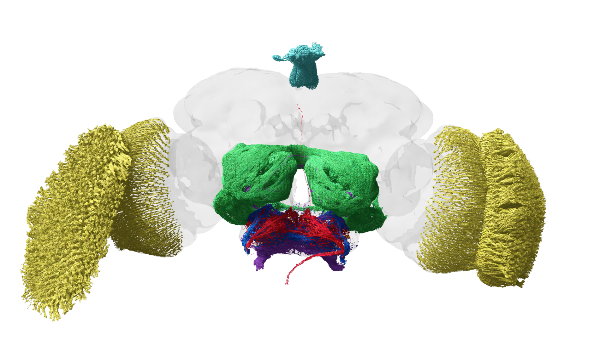

# 01. 왜 초파리인가

## 작아서 좋은 것이 아니라, 연구하기 좋게 작다

초파리는 사람보다 훨씬 적은 수의 뉴런을 가지고 있습니다. 그렇다고 행동이 한두 가지뿐인 생물은 아닙니다. 연구자는 상대적으로 작은 신경계에서 감각·학습·움직임·보상 회로를 함께 살펴볼 수 있습니다.

초파리를 연구 모델로 쓰는 이유는 네 가지로 정리할 수 있습니다.

| 이유 | 설명 |
|---|---|
| 크기 | 전체 신경계를 전자현미경으로 추적하는 일이 포유류보다 현실적입니다. |
| 행동 | 걷기, 날기, 냄새 찾기, 짝짓기, 위험 회피처럼 관찰 가능한 행동이 많습니다. |
| 유전학 | 특정 뉴런이나 신경전달물질의 역할을 조작하고 비교하기 쉽습니다. |
| 공개 데이터 | 여러 연구팀이 연결 지도와 세포 유형 정보를 공개하고 있습니다. |

그림 01. 뇌로 들어오는 감각 뉴런. 감각 입력의 여러 통로를 보여 준다. 데이터: FlyWire.ai. 렌더링: Philipp Schlegel (University of Cambridge/MRC LMB). [원본 갤러리](https://flyconnecto.me/media/) · [CC BY 4.0](https://creativecommons.org/licenses/by/4.0/). 제공된 1920×1080 파일을 수정 없이 수록.

## 뇌를 이해하는 세 가지 질문

초파리 뇌 연구는 보통 다음 질문을 함께 다룹니다.

1. **어떤 신호를 받는가?** 빛, 냄새, 접촉, 온도처럼 외부 자극을 확인합니다.
2. **어디에서 계산하는가?** 입력이 어떤 뉴런과 회로를 거치는지 추적합니다.
3. **어떤 행동으로 나오는가?** 걷기, 방향 전환, 회피, 접근 등의 결과를 측정합니다.

이 세 질문을 연결해야 “이 뉴런이 행동을 만든다”는 주장을 조심스럽게 검토할 수 있습니다. 연결되어 있다는 사실만으로 원인이라고 단정할 수는 없습니다.

## 초파리 뇌와 인간 뇌를 비교할 때의 주의점

초파리의 회로에서 인간 뇌와 비슷한 원리가 발견될 수는 있습니다. 예를 들어 감각 정보를 여러 단계로 처리하거나, 보상 신호를 이용해 행동을 바꾸는 방식은 다양한 동물에서 반복해서 나타납니다.

하지만 “초파리의 특정 뉴런 = 인간의 특정 뇌 부위”처럼 일대일 대응을 만들면 안 됩니다. 크기, 세포 종류, 신체 구조, 학습 방식이 다르기 때문입니다. 초파리는 인간 뇌의 축소판이 아니라, 신경계가 정보를 처리하는 일반 원리를 시험하는 모델입니다.

## ‘모델 생물’이라는 말

모델 생물은 연구하려는 질문을 다루기에 적합한 생물을 뜻합니다. 모든 생물의 특징을 대표한다는 뜻은 아닙니다. 연구 도구와 자료가 많이 쌓이면 새 실험을 앞선 결과와 연결하기 쉬워집니다. 하나의 좋은 실험뿐 아니라 서로 비교할 수 있는 많은 실험이 중요합니다.

초파리에서 특정 회로를 찾았다는 소식을 들으면 “이 회로가 어떤 질문의 모델인가?”를 물어보세요. 냄새 학습을 연구한 결과를 언어 이해나 사람의 성격으로 즉시 확장할 수는 없습니다. 연구 대상의 강점과 적용 범위를 함께 보는 습관이 필요합니다.

## 관찰에서 실험으로

설명용 상황을 생각해 봅시다. 먹이가 있는 방향으로 초파리가 많이 이동합니다. 이것은 냄새 때문일 수도 있고, 빛이나 온도 차이 때문일 수도 있습니다. 냄새가 원인이라는 주장을 강화하려면 다른 조건을 같게 하거나 조건을 바꾸어 비교해야 합니다.

이때 커넥톰은 냄새 입력과 행동 관련 회로 사이의 후보 경로를 찾게 해줍니다. 지도에서 후보를 찾고, 실제로 조작하고, 행동이 달라지는지 확인하는 식으로 질문을 좁힙니다. 지도가 실험을 대신하지는 않지만 실험 대상을 더 구체적으로 정하는 데 도움을 줍니다.

| 처음 떠올린 생각 | 더 정확한 연구 질문 |
|---|---|
| 초파리가 먹이를 좋아한다 | 어떤 자극 조건에서 접근이 증가하는가 |
| 이 세포가 기억이다 | 이 세포의 조작이 어떤 기억 과제에 영향을 주는가 |
| 뇌 지도가 완성됐다 | 어느 표본과 범위가 어떤 기준으로 재구성됐는가 |

출처: [세포 유형과 연구 자원을 정리한 논문](https://doi.org/10.1038/s41586-024-07686-5). 먹이 접근 상황은 저자의 설명용 사례입니다.

## 이미지 읽기: 예쁜 색은 기능이 아니다

커넥톰 이미지는 여러 색의 선과 구체로 표현되는 경우가 많습니다. 색은 뉴런 그룹이나 영역을 구분하기 위한 시각적 약속일 수 있으며, 실제 뇌 안에 그런 색이 존재한다는 뜻은 아닙니다.

> **이미지 참고**
>
> FlyWire 공식 미디어 갤러리의 3D 렌더링은 전체 초파리 뇌와 주요 뉴런을 시각적으로 보여줍니다. 갤러리 안내에 따라 저작자와 데이터 출처를 캡션에 함께 표기해야 합니다.
>
> 출처: [Fly Connectome Media](https://flyconnecto.me/media/) — 데이터 출처 FlyWire.ai, 렌더링 저작자 페이지별 표기. 갤러리 안내상 CC BY.
