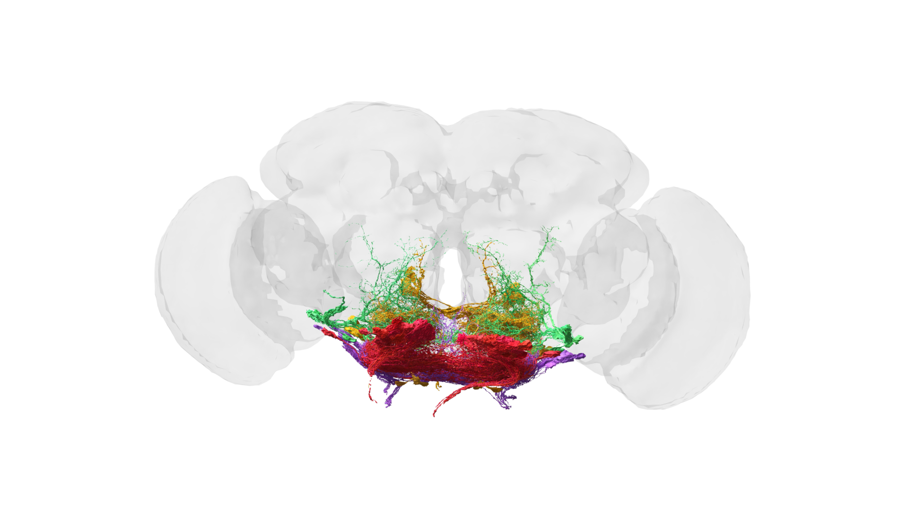

# 02. 뉴런과 시냅스를 쉽게 이해하기

## 뉴런은 전선이 아니라 작은 신호 처리 장치다

뉴런은 전기 신호를 전달하는 세포입니다. 그러나 단순한 전선과 다릅니다. 뉴런은 여러 입력을 받아 합치고, 조건이 맞으면 다음 뉴런으로 신호를 보냅니다.

| 부분 | 역할 | 비유 |
|---|---|---|
| 수상돌기 | 다른 세포의 신호를 받음 | 안테나 |
| 세포체 | 입력을 모으고 상태를 유지함 | 제어실 |
| 축삭 | 신호를 멀리 전달함 | 케이블 |
| 시냅스 | 다음 세포에 신호를 건넴 | 접속 지점 |

그림 02. 뇌의 구기 운동 뉴런. 모든 다리 근육의 운동 뉴런을 그린 그림이 아니다. 데이터: FlyWire.ai. 렌더링: Philipp Schlegel (University of Cambridge/MRC LMB). [원본 갤러리](https://flyconnecto.me/media/) · [CC BY 4.0](https://creativecommons.org/licenses/by/4.0/). 제공된 1920×1080 파일을 수정 없이 수록.

## 시냅스는 연결의 강도를 가진다

두 뉴런이 연결되어 있다는 것은 출발점일 뿐입니다. 연결 지점의 수, 신호를 촉진하는지 억제하는지, 신경전달물질의 종류에 따라 회로의 영향력이 달라질 수 있습니다.

그래서 커넥톰에서는 “A와 B가 연결됐다”뿐 아니라 다음 정보를 함께 살펴봅니다.

- 연결 방향: A에서 B로 가는가, 양방향인가
- 시냅스 수: 연결이 몇 개의 시냅스로 구성되는가
- 세포 유형: 어떤 역할을 하는 뉴런인가
- 위치: 감각 영역·중간 처리 영역·운동 영역 중 어디에 있는가

## 커넥톰 데이터의 단위

연구자가 말하는 “뉴런 수”와 “연결 수”는 서로 다른 숫자입니다. 뉴런 하나가 수천 개의 다른 뉴런과 연결될 수 있으므로, 뉴런 수가 14만 개라고 해서 연결도 14만 개뿐이라는 뜻은 아닙니다.

| 단위 | 의미 |
|---|---|
| 뉴런 | 신호를 처리하고 전달하는 세포 |
| 시냅스 | 뉴런 사이의 신호 전달 접점 |
| 세포 유형 | 구조와 연결 패턴이 비슷한 뉴런 분류 |
| 회로 | 특정 감각이나 행동과 관련된 연결 묶음 |

## 흥분과 억제는 감정 표현이 아니다

신경과학에서 흥분은 대체로 다음 세포의 활동을 촉진하는 방향의 효과를, 억제는 줄이는 방향의 효과를 가리킬 때 사용합니다. 사람이 흥분하거나 감정을 억누른다는 일상 표현과 구분해야 합니다. 구체적 효과는 전달물질 이름만이 아니라 수용체와 세포 조건에도 영향을 받습니다.

서로 다른 입력이 한 세포에 도착하면 그 영향이 함께 작용합니다. 어느 신호가 언제 도착했는지에 따라 결과가 달라질 수 있습니다. 연결 개수만 세는 것과 시간에 따른 계산을 하는 것이 다른 이유입니다.

## 뉴런 수, 시냅스 수, 간선 수

가상의 작은 회로에 A, B, C라는 뉴런 세 개가 있다고 해봅시다. A→B 사이에 접점 4개, A→C 사이에 접점 2개가 있으면 뉴런은 3개, 접점은 6개, 방향을 구분한 연결 쌍은 2개입니다. 이 세 숫자는 모두 같은 회로를 설명합니다.

| 세는 대상 | 가상 회로의 값 | 질문 |
|---|---|---|
| 세포 | 3 | 처리 단위가 몇 개인가 |
| 접점 | 6 | 전달 지점을 몇 개 세었나 |
| 연결 쌍 | 2 | 어느 세포에서 어느 세포로 연결되는가 |

연결 쌍마다 접점을 세 개 이상 요구하는 필터를 적용하면 A→C는 목록에서 빠집니다. 생물의 연결이 없어졌다는 뜻이 아니라 표시·분석 기준이 달라진 것입니다. 논문과 화면의 숫자가 다를 때 이 가능성부터 확인합니다.

또한 초파리의 화학 시냅스에는 한 전달 지점에 여러 후시냅스 상대가 관계할 수 있는 구조가 있습니다. 데이터에서 어떤 단위를 세는지 확인해야 원시 접점 수와 세포 간 연결 수를 잘못 비교하지 않습니다.

출처: [성체 초파리 뇌 재구성 논문](https://doi.org/10.1038/s41586-024-07558-y). A·B·C 수치는 개념 설명을 위해 만든 예시입니다.

## 왜 ‘배선도’만으로는 부족한가

같은 배선도라도 뉴런의 현재 상태, 신경전달물질의 양, 몸의 움직임, 외부 자극에 따라 결과가 달라질 수 있습니다. 건물의 전기 배선도를 본다고 해서 그 안에서 지금 어떤 기기가 켜져 있는지 바로 알 수 없는 것과 비슷합니다.

따라서 커넥톰 연구는 전자현미경 이미지, 행동 실험, 신경 활동 기록, 계산 모델을 함께 사용합니다.
