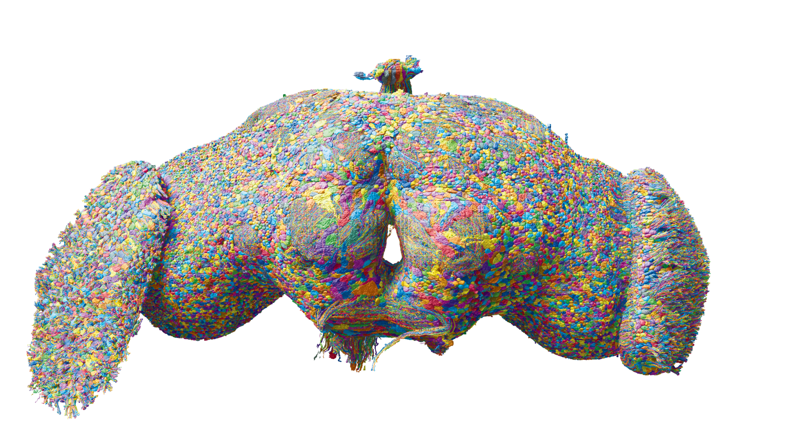

# 03. 커넥톰이란 무엇인가


## 뇌의 도로 지도를 만드는 과정

커넥톰을 만드는 일은 사진 한 장을 찍는 것과 다릅니다. 연구자는 뇌를 매우 얇게 나누고, 각 조각을 전자현미경으로 촬영한 뒤, 여러 이미지에서 같은 뉴런의 가지가 어떻게 이어지는지 복원합니다.

과정을 단순화하면 다음과 같습니다.

```text
뇌 표본 준비 → 아주 얇게 절단 → 전자현미경 촬영
      → AI 기반 세포·가지 추적 → 사람의 교정·주석
      → 뉴런·시냅스 연결 지도 → 행동·회로 연구
```



그림 03. 성체 암컷 초파리 뇌 전체의 재구성. 색은 실제 조직의 색이 아니다. 데이터: FlyWire.ai. 렌더링: Philipp Schlegel (University of Cambridge/MRC LMB). [원본 갤러리](https://flyconnecto.me/media/) · [CC BY 4.0](https://creativecommons.org/licenses/by/4.0/). 제공된 1920×1080 파일을 수정 없이 수록.

## AI가 모두 해주는 것은 아니다

이미지 수가 매우 많기 때문에 AI는 세포 경계를 추정하고 선을 이어 붙이는 데 도움을 줍니다. 하지만 비슷하게 보이는 가지가 이어져 있거나 끊어진 경우에는 오류가 생길 수 있습니다. 그래서 연구자와 커뮤니티가 결과를 검토하고 수정합니다.

이 지점이 중요합니다. 커넥톰은 “AI가 한 번에 읽어낸 정답”이 아니라 자동 분석과 사람의 검증이 결합된 데이터 제품입니다.

## 지도는 질문에 맞게 펼쳐 본다

도로 지도도 도시 전체를 볼 때와 골목을 찾을 때 배율이 다릅니다. 커넥톰에서도 전체 네트워크의 경향, 특정 영역의 회로, 세포 하나의 상대를 다른 수준에서 봅니다. 어느 수준의 분석인지 먼저 정하면 수많은 선에 압도되지 않습니다.

| 관찰 수준 | 좋은 출발 질문 | 주의점 |
|---|---|---|
| 전체 뇌 | 어떤 큰 영역이 연결되는가 | 작은 회로의 기능을 단정하지 않기 |
| 영역 | 입력과 출력이 어디로 가는가 | 영역 경계와 포함 기준 확인 |
| 세포 유형 | 비슷한 세포가 어떤 패턴을 보이는가 | 유형과 개체를 혼동하지 않기 |
| 세포 하나 | 직접 연결된 상대는 누구인가 | 약한 연결의 필터 확인 |

## 배선 지도와 실제 흐름

그림에서 화살표가 A→B→C로 이어져 있으면 A의 모든 신호가 언제나 C에 도달한다고 생각하기 쉽습니다. 하지만 B의 상태나 다른 입력에 따라 C의 반응이 달라질 수 있습니다. 회로 안에 되먹임이 있으면 한 번의 일방향 전달로 설명하기도 어렵습니다.

이 때문에 연구자는 연결 지도 위에 시간 규칙을 얹은 모델을 만들기도 하고, 실제 활동 기록과 비교하기도 합니다. 07장에서는 증거의 차이를, 10장에서는 계산 모델의 규칙을 자세히 다룹니다.

## 작은 읽기 연습

“이 세포는 연결 상대가 많으므로 가장 중요한 세포다”라는 문장을 평가해 보세요. 연결 상대가 많다는 것은 구조에 관한 설명입니다. 중요하다는 말은 어떤 과제에서 무엇을 바꾸는지 정의해야 평가할 수 있습니다. 행동의 시작에 중요한 세포와 장시간 유지에 중요한 세포가 다를 수도 있습니다.

이 책에서는 큰 숫자나 화려한 그림을 본 뒤 바로 기능을 부여하기보다, 어떤 검증이 더 필요한지 한 단계씩 묻습니다. 이러한 독법은 다음 기술의 유행을 볼 때도 활용할 수 있습니다.


## 2024년 암컷 뇌 커넥톰

자료 출처: [성체 암컷 뇌 논문](https://doi.org/10.1038/s41586-024-07558-y), [MaleCNS 공개 이력](https://male-cns.janelia.org/). 두 자료는 재구성 범위가 다르다.

FlyWire 컨소시엄은 성체 암컷 초파리 뇌의 뉴런과 시냅스 연결을 전체적으로 재구성했습니다. Nature 논문은 약 139,255개 뉴런과 5,450만 개의 시냅스 연결을 보고했습니다. [Nature 논문](https://doi.org/10.1038/s41586-024-07558-y)

## 2026년 수컷 중추신경계 커넥톰

MaleCNS의 공개 이력은 초기 버전 공개, v1.0 공개, 논문 출판으로 나누어 읽어야 합니다. 2025년 10월 초기 버전이 공개되었고 2026년 6월 v1.0, 9월 논문 출판이 이어졌습니다. 뇌와 신경삭을 포함하는 범위가 암컷 뇌 자료와 다르므로 총수만으로 성별 차이를 해석하지 않습니다. [MaleCNS 공식 공개 이력](https://male-cns.janelia.org/)

> **주의할 점**
>
> 완전한 커넥톰이라는 표현은 모든 연결을 같은 정확도로 측정했다는 뜻이 아닙니다. 연구팀이 정한 품질 기준을 통과한 재구성 데이터라는 뜻이며, 주석과 해석은 계속 갱신될 수 있습니다.
