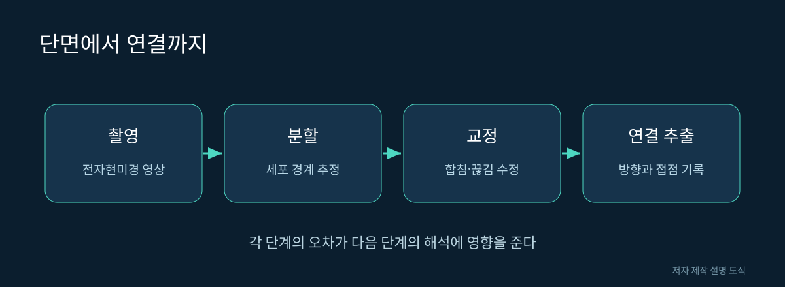

# 04. 뇌 한 조각에서 연결 지도까지

과일을 얇게 썰었다고 해서 그 안의 모든 혈관 같은 통로를 알아볼 수 있는 것은 아닙니다. 각 단면에서 보이는 점이 다음 단면의 어느 점으로 이어지는지 찾아야 합니다. 뇌를 재구성하는 작업도 이 문제를 풀어 갑니다. 아주 가는 신경 가지가 서로 가까이 지나가는 곳에서는 연결을 잘못 붙이기 쉽습니다.

## 사진, 분할, 교정은 서로 다른 작업이다

전자현미경은 구조를 촬영합니다. 촬영 결과에 곧바로 뉴런 이름이 붙어 있는 것은 아닙니다. 세포 경계를 추정하고 같은 세포에 속하는 부분을 묶는 작업을 분할이라고 부릅니다. 그 결과를 사람이 확인하는 과정이 교정입니다. 마지막으로 세포 유형과 뇌 영역 같은 설명을 붙이는 것이 주석입니다.

| 단계 | 입력 | 얻는 결과 | 대표적인 실패 |
|---|---|---|---|
| 촬영 | 준비한 표본 | 단면 영상 | 손상·정렬 문제 |
| 분할 | 많은 영상 | 세포별 덩어리 | 다른 세포를 합침 |
| 교정 | 분할 결과와 원본 | 수정한 세포 구조 | 가는 가지를 놓침 |
| 시냅스 식별 | 세포 사이 접점 | 방향이 있는 연결 | 접점 누락·오검출 |
| 주석 | 형태와 연결 정보 | 유형·영역·설명 | 미분류·분류 변경 |

지도 제작과 지도 해석의 차이를 알아야 합니다. 가지를 정확히 이어 붙였더라도 그 세포가 어떤 행동에 기여하는지는 별도 실험이 필요합니다. 반대로 세포 이름이 아직 없어도 구조 자료가 무가치한 것은 아닙니다.

그림 04. 단면에서 연결까지. 저자 제작 SVG 설명 도식. 실제 신경 구조의 측정 이미지가 아니다.

## 합치기 오류와 쪼개기 오류

서로 다른 두 뉴런을 하나로 묶으면 원래 존재하지 않던 지름길이 생깁니다. A가 B를 거쳐 C로 연결된 것처럼 보여도 사실은 두 세포가 잘못 붙은 결과일 수 있습니다. 한 뉴런을 두 개로 쪼개면 신호가 지나갈 길이 끊어진 것처럼 보입니다.

이 두 오류는 그래프 분석에 서로 다른 영향을 줍니다. 전자는 지나치게 중심적인 세포를 만들어 낼 수 있고, 후자는 실제 연결을 약하게 평가하게 만듭니다. 그래서 예쁜 3D 그림만 보고 데이터 품질을 판단하기 어렵습니다.

## 지도에는 버전이 필요하다

교정과 주석은 계속 바뀔 수 있습니다. 오늘 찾은 세포 식별자가 오래된 논문 속 식별자와 다르면, 먼저 데이터 버전과 식별자 대응을 확인해야 합니다. 다른 버전을 섞어 놓고 생물학적 차이라고 해석하면 안 됩니다.

**직접 해보기:** 자료 하나를 골라 표본, 데이터 이름, 버전, 다운로드 날짜를 적어 보세요. 그 뒤 논문의 출판 날짜를 따로 적습니다. 이 다섯 항목이 다른 연구자에게 같은 지도를 찾아가는 주소 역할을 합니다.

## 예시: 잘못 이어 붙인 가지가 만드는 오해

가상의 재구성에서 뉴런 A와 D의 가지가 한 곳에서 잘못 합쳐졌다고 합시다. 프로그램은 이를 하나의 세포로 취급하므로 A의 입력과 D의 출력을 한 경로로 계산할 수 있습니다. 분석자는 그 세포가 두 영역을 이어 주는 중요한 다리라고 결론 낼 수도 있습니다.

원본 영상으로 돌아가 합치기 오류를 수정하면 그 다리가 사라집니다. 이 사례에서 바뀐 것은 생물학적 회로가 아니라 연구자가 가진 표현입니다. 그래서 놀라운 지름길이나 유난히 큰 연결 중심을 발견하면 구조 품질을 다시 확인하는 것이 좋습니다.

교정 작업을 단순한 마무리 청소로 보면 이러한 중요성을 놓칩니다. 교정은 데이터에서 제기할 수 있는 질문의 신뢰도를 높이는 연구 과정입니다. 어느 부분이 얼마나 검토되었는지 기록하는 일도 결과 해석의 일부입니다.

## 원본을 보존하는 이유

보기 좋게 만든 렌더링에는 원본 영상의 모든 세부 정보가 들어 있지 않습니다. 렌더링은 형태를 비교하기 좋고, 단면 영상은 경계와 접점을 검토하기 좋습니다. 두 자료는 경쟁 관계가 아니라 목적이 다른 창입니다. 독자가 책 그림을 확대해도 접점을 확인할 수 없다면 원본 데이터 탐색 도구가 필요한 이유가 여기에 있습니다.

## 생각해 볼 질문

교정 전후에 연결 수가 증가했다면 초파리가 새로운 기억을 배웠다는 뜻일까요? 아닙니다. 같은 표본의 재구성이 개선되었을 가능성을 먼저 검토해야 합니다. 데이터의 변화와 살아 있는 뇌의 변화를 구분하는 것이 첫 번째 연구 습관입니다.

출처: [FlyWire 공식 프로젝트](https://flywire.ai/), [Codex FAQ](https://codex.flywire.ai/faq). 단계 설명과 오류 사례는 이해를 돕기 위한 저자 설명입니다.
