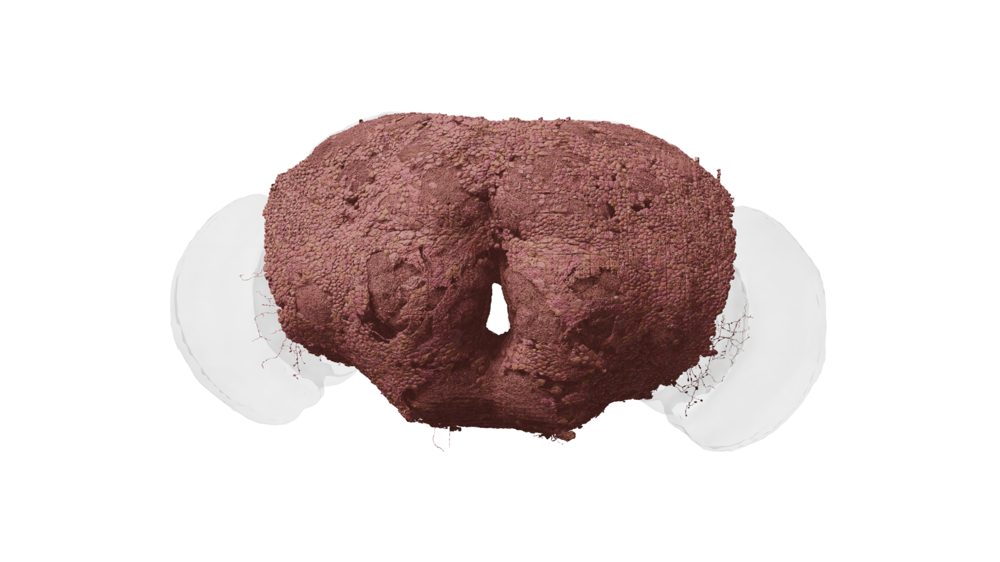

# 05. 암컷 초파리 뇌 지도에서 읽을 수 있는 것

전체 뇌 이미지를 처음 보면 수많은 선이 뒤엉켜 있어 무엇부터 봐야 할지 막막합니다. 이때 목표를 “모든 선을 이해하기”로 잡으면 금방 지칩니다. 먼저 전체 범위, 영역, 세포 하나, 연결 상대 순서로 관찰 단위를 좁혀 보세요.

## ‘전체 뇌’의 범위를 먼저 확인한다

FlyWire의 2024년 성체 암컷 뇌 지도는 신경계를 통째로 그린 자료와 구분해야 합니다. 뇌에서 몸으로 내려가는 연결을 포함하더라도, 몸속 신경삭 전체가 같은 범위로 재구성되어 있다는 뜻은 아닙니다. 뇌 자료와 중추신경계 자료의 총수를 그대로 비교하면 영역 차이를 성별 차이로 착각하기 쉽습니다.

| 질문 | 확인할 위치 | 잘못된 해석 |
|---|---|---|
| 어느 동물인가 | 표본 설명 | 모든 초파리의 평균이라고 생각함 |
| 어느 발달 단계인가 | 논문 방법 | 유충과 성체를 혼합함 |
| 어디까지 포함하나 | 재구성 범위 | 뇌와 몸 전체를 동일시함 |
| 어떤 숫자인가 | 표·범례 | 시냅스와 세포 쌍을 혼동함 |
| 어느 시점 자료인가 | 버전 기록 | 현재 화면과 논문 숫자가 반드시 같아야 한다고 생각함 |

그림 05. 중앙 뇌 내부 뉴런의 부분집합. 전체 뇌 그림과 재구성 범위를 비교하자. 데이터: FlyWire.ai. 렌더링: Philipp Schlegel (University of Cambridge/MRC LMB). [원본 갤러리](https://flyconnecto.me/media/) · [CC BY 4.0](https://creativecommons.org/licenses/by/4.0/). 제공된 1920×1080 파일을 수정 없이 수록.

## 선의 모양과 연결을 함께 본다

세포 가지가 길게 뻗어 있으면 멀리 떨어진 영역을 연결할 가능성을 생각해 볼 수 있습니다. 하지만 길다는 이유로 중요한 세포라고 단정하지는 않습니다. 짧은 범위에서 작동하는 세포도 특정 계산에 결정적으로 기여할 수 있습니다.

또한 두 가지가 그림에서 겹쳐 보인다고 시냅스가 있다고 판단할 수 없습니다. 3차원 공간을 평면으로 그리면 앞뒤로 떨어진 가지가 겹쳐 보입니다. 접촉 여부는 연결 정보나 원본 영상으로 확인해야 합니다.

## 색상은 범례와 함께 읽는다

같은 색이 같은 세포 유형을 뜻하는지, 같은 뇌 영역을 뜻하는지, 아니면 서로 구분하기 위해 임의로 붙인 색인지 확인하세요. 한 그림의 파란색과 다른 그림의 파란색이 동일한 기능을 뜻한다는 보장은 없습니다. 색을 생물학적 주장으로 바꾸기 전에 범례를 읽는 습관이 필요합니다.

## 세포 유형은 폴더 이름처럼 사용한다

수많은 파일을 하나씩 열기보다 종류별 폴더를 만들면 탐색이 쉬워집니다. 세포 유형도 복잡한 자료를 비교하는 공통 언어로 사용할 수 있습니다. 다만 폴더의 내용이 계속 정리되듯 유형 분류도 연구에 따라 수정될 수 있습니다.

같은 유형의 세포라고 해서 모든 연결이 완전히 동일하다고 가정하지 않습니다. 유형은 공통 특징을 묶는 분류이고, 개별 세포는 특정 표본에서 관찰한 하나의 대상입니다. 검색 결과에 같은 유형 이름이 여러 번 나오는 것은 반드시 중복 오류가 아닙니다.

## 관찰표를 작성하는 예

| 내가 쓴 문장 | 분류 | 다음 확인 |
|---|---|---|
| 가지가 두 영역으로 뻗어 있다 | 형태 관찰 | 영역 주석 확인 |
| 두 영역 사이의 신호를 전달할 것이다 | 기능 가설 | 연결 방향·활동 실험 |
| 이 세포가 없으면 행동을 못 할 것이다 | 인과 가설 | 억제·대조 실험 |

이처럼 문장을 분류하면 모르는 것이 무엇인지 선명해집니다. “뇌를 모르겠다”라는 막연한 상태에서 “형태는 확인했지만 기능은 검증하지 못했다”라는 구체적 상태로 옮겨갈 수 있습니다. 이 차이가 실제 데이터를 읽는 학습의 핵심입니다.

## 한 표본으로 어디까지 말할 수 있을까

이 지도는 매우 풍부하지만 하나의 표본에서 얻은 구조입니다. 여기서 발견한 패턴이 여러 개체에서도 반복되는지 확인해야 종 전체에 관한 주장으로 넓힐 수 있습니다. 한 사람의 도시 이동 기록으로 모든 시민의 생활을 설명할 수 없는 것과 비슷합니다.

**관찰 노트 예시:** “전체 뇌에서 좌우로 넓게 퍼진 구조가 보인다”는 관찰입니다. “좌우 구조가 똑같이 작동한다”는 가설입니다. 책이나 블로그에 쓸 때도 두 문장을 구분하세요.

출처: [Dorkenwald 등, 성체 뇌 배선도 논문](https://doi.org/10.1038/s41586-024-07558-y), [Schlegel 등, 세포 유형 주석 논문](https://doi.org/10.1038/s41586-024-07686-5).
