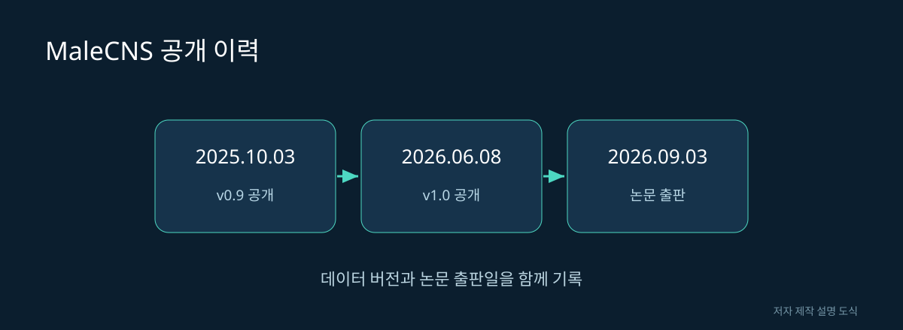

# 06. 수컷 중추신경계 지도와 연구의 확장

뇌가 “앞으로 가라”고 명령하면 다리가 저절로 정확하게 움직일까요? 실제로는 다리의 자세와 접촉 상태에 따라 움직임을 계속 조절해야 합니다. 뇌와 몸을 연결하는 신경삭까지 보면 행동을 더 넓은 범위에서 질문할 수 있습니다.

## 공개 날짜를 하나로 합치지 않는다

MaleCNS 공식 페이지는 2025년 10월 3일 v0.9 공개, 2026년 6월 8일 v1.0 공개, 2026년 9월 3일 논문 출판을 구분합니다. 따라서 “2026년 9월에 처음 모든 데이터가 공개됐다”라고 쓰면 그 이전 공개 이력을 빠뜨립니다.

| 사건 | 의미 | 독자가 확인할 것 |
|---|---|---|
| 초기 데이터 공개 | 먼저 탐색할 수 있는 자료 제공 | 잠정 분류와 버전 |
| 정식 버전 공개 | 특정 시점 데이터 고정 | 릴리스 번호 |
| 논문 출판 | 방법과 분석 결과 발표 | 출판본과 부록 |
| 이후 주석 갱신 | 세포 설명 개선 | 현재 화면과 기록 차이 |

그림 06. MaleCNS 공개 이력. 저자 제작 SVG 설명 도식. 실제 신경 구조의 측정 이미지가 아니다.

## 뇌와 신경삭을 함께 보는 이유

신경삭은 뇌 아래에서 몸의 감각과 운동을 연결하는 중추신경계 구조입니다. 인간의 척수에 비유하면 위치와 역할을 이해하는 데 도움이 되지만, 구조가 그대로 같다는 뜻은 아닙니다.

가상의 보행 실험을 생각해 봅시다. 뇌의 특정 활동이 방향 전환과 함께 나타납니다. 이것이 다리를 직접 구동하는 신호인지, 다른 회로의 상태를 바꾸는 신호인지 알려면 아래쪽 연결을 따라가야 합니다. 몸에서 올라오는 정보가 그 활동을 다시 바꾸는지도 살펴봐야 합니다.

## 하행과 상행을 구별한다

하행 뉴런은 뇌에서 신경삭 쪽으로 내려가는 정보 전달을, 상행 뉴런은 반대 방향의 전달을 설명할 때 사용하는 말입니다. 화면에서 선이 아래로 그려져 있다는 뜻과 같지 않습니다. 렌더링을 회전해도 정보 전달 방향의 정의는 바뀌지 않습니다.

이 용어를 알면 몸이 뇌의 지시를 받기만 하는 구조가 아니라는 점을 이해하기 쉽습니다. 몸의 상태와 감각 결과가 다시 올라와 이후 행동에 영향을 줄 수 있습니다. 단순한 명령 목록으로 행동을 설명하려는 관점에서 상호작용을 보는 관점으로 넓어지는 것입니다.

## 비교 보고서의 최소 단위

수컷과 암컷의 차이를 블로그에 쓸 때는 “수컷 자료에서는 이 유형을 확인했고, 암컷 자료에서는 이 대응 유형과 비교했다”처럼 비교 대상을 명확히 적습니다. 어느 쪽에서 검색되지 않았다는 이유만으로 그 생물에 세포가 없다고 단정하면 안 됩니다. 명명 규칙과 미주석 상태가 원인일 수 있습니다.

검토한 페이지의 링크, 유형 이름, 버전, 범위를 남기세요. 이것이 있어야 나중에 분류가 바뀌어도 글을 수정할 수 있습니다. 연구가 발전해 표기가 바뀌는 것은 처음 기록이 무용하다는 뜻이 아니라 기록을 갱신해야 한다는 뜻입니다.

## 성별 비교는 무엇을 요구하는가

수컷 자료와 암컷 자료의 총 뉴런 수만 비교하면 충분하지 않습니다. 대응하는 영역과 세포 유형을 찾고, 같은 기준으로 연결을 세어야 합니다. 개체 차이와 데이터 품질 차이도 영향을 줄 수 있습니다.

관찰된 차이가 성별과 관련된 행동에 기여한다는 가설을 세울 수는 있습니다. 그러나 특정 연결의 차이가 곧 행동의 유일한 원인이라고 말하려면 추가적인 조작 실험이 필요합니다.

**읽기 연습:** 두 자료의 비교표를 만들되 첫 열에는 성별보다 재구성 범위를 적어 보세요. 범위가 다른 숫자를 같은 칸에 넣지 않는 것만으로도 많은 오해를 줄일 수 있습니다.

출처: [MaleCNS 공식 프로젝트의 공개 이력](https://male-cns.janelia.org/), [릴리스 노트](https://male-cns.janelia.org/release/). 본 장의 보행 사례는 설명용 가정입니다.
