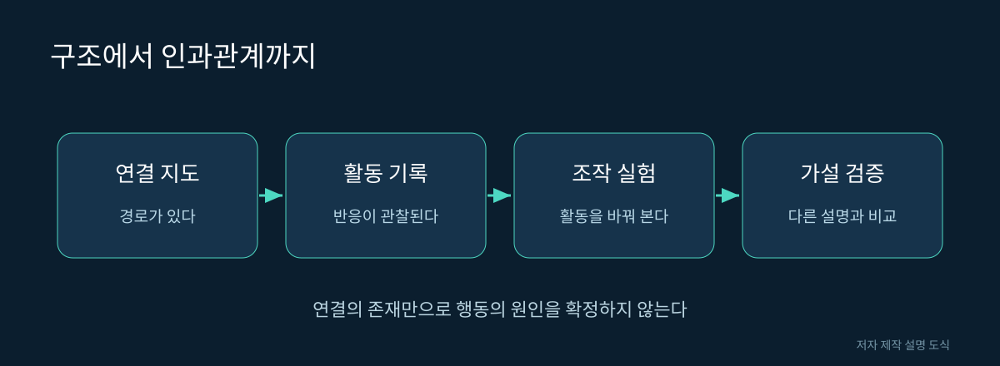

# 07. 연결되어 있다는 것과 작동한다는 것

A 뉴런에서 B 뉴런으로 시냅스가 있습니다. 이 사실로 무엇을 말할 수 있을까요? 신호 전달의 구조적 경로가 있다는 것은 말할 수 있습니다. 하지만 지금 B가 활발한지, A를 자극하면 언제나 B가 같은 방식으로 반응하는지는 아직 모릅니다.

## 구조, 활동, 인과관계

| 증거 | 얻는 정보 | 남는 질문 |
|---|---|---|
| 연결 지도 | 가능한 전달 경로 | 실제 사용되는가 |
| 활동 기록 | 자극과 반응의 시간 관계 | 다른 원인이 함께 작용하는가 |
| 활성화 실험 | 자극했을 때의 변화 | 자연 상태에서도 같은가 |
| 억제 실험 | 활동을 줄였을 때의 변화 | 다른 회로가 보상하는가 |
| 모델 예측과 실험 비교 | 가설의 예측력 | 다른 조건에서도 맞는가 |

“함께 활동한다”는 관찰은 인과관계의 출발점입니다. 예를 들어 A와 B가 동시에 활성화되어도 A가 B를 움직였다는 보장은 없습니다. 둘 다 C의 영향을 받았을 수 있습니다. 구조 정보와 활동 측정을 함께 사용하면 후보 설명을 줄일 수 있습니다.

그림 07. 구조에서 인과관계까지. 저자 제작 SVG 설명 도식. 실제 신경 구조의 측정 이미지가 아니다.

## 시냅스 수는 곧 전류의 크기가 아니다

가상의 데이터에서 A→B 접점은 20개, C→B 접점은 10개라고 해봅시다. 이를 계산 모델에 넣을 때 A의 가중치를 두 배로 놓을 수 있습니다. 그러나 이것은 모델의 가정입니다. 실제 효과는 수용체, 전달물질, 시간 특성, 세포 상태에 따라 달라집니다.

이 예시에서 “접점 수가 두 배”는 자료의 설명이고 “영향력이 정확히 두 배”는 해석입니다. 둘을 분리해 기록하면 모델이 틀렸을 때 어느 가정을 바꿔야 하는지 찾을 수 있습니다.

## 필요조건과 충분조건

어떤 세포를 억제하자 행동이 줄었다면 그 조건에서 행동에 필요할 가능성이 있습니다. 세포를 인위적으로 활성화하자 행동이 생겼다면 그 조작이 행동을 유발하기에 충분했을 가능성이 있습니다. 이 두 결과는 같은 말이 아닙니다.

집의 전등 스위치를 끄면 방이 어두워집니다. 하지만 방이 어두워진 원인이 항상 그 스위치인 것은 아닙니다. 정전도 원인이 될 수 있습니다. 행동 실험도 주변 조건을 함께 확인해야 합니다.

## 대조 실험을 함께 설계한다

가상의 회로에서 A를 활성화하자 회전 행동이 늘었습니다. 자극 장치 자체의 빛이나 열이 행동을 바꾸었을 가능성도 생각해야 합니다. 따라서 가능한 조건에서 동일한 자극을 주되 목표 세포가 조작되지 않는 대조 조건을 비교합니다.

또한 회전이 늘었다는 표현을 수치로 정해야 합니다. 회전 횟수인지, 회전 각도인지, 전체 시간 중 회전한 비율인지에 따라 결론이 달라질 수 있습니다. 움직임이 전반적으로 느려져 직진이 줄었는데 상대적으로 회전 비율이 높아진 것일 수도 있습니다.

| 모호한 표현 | 더 측정 가능한 표현 |
|---|---|
| 더 활발해졌다 | 일정 시간의 이동 거리 변화 |
| 회전을 잘한다 | 특정 자극 후 방향 오차 변화 |
| 기억력이 좋아졌다 | 정해진 지연 뒤 선택 비율 변화 |

이 표는 결과를 새로 만들어 넣기 위한 것이 아니라 앞으로 어떤 값을 측정해야 하는지 정하는 도구입니다. 측정 기준을 결과를 본 다음에 유리하게 바꾸지 않고 미리 정하면 해석의 자유도를 줄일 수 있습니다.

## 모델을 평가하는 작은 사고실험

가상의 회로가 먹이 자극에서만 잘 작동한다고 해봅시다. 빛이나 접촉 자극에서 실패했다면 모델 전체가 쓸모없는 것은 아닙니다. 검증된 범위를 먹이 관련 입력으로 한정해야 합니다. 좋은 설명은 성공 사례와 실패 조건을 함께 보여줍니다.

출처: [Shiu 등, 감각운동 처리 계산 모델](https://doi.org/10.1038/s41586-024-07763-9). 비교표와 수치 사례는 저자의 교육용 예시이며 실험 결과가 아닙니다.
