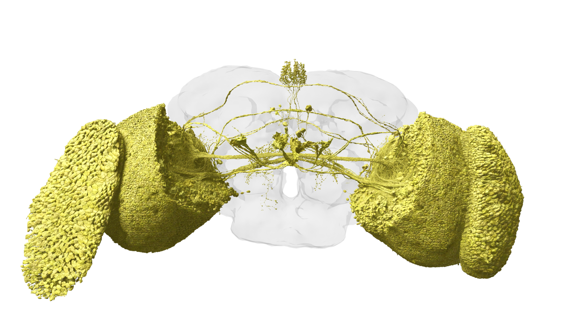

# 08. 초파리는 움직임을 어떻게 읽는가

정지 사진 한 장으로 공이 왼쪽으로 가는지 오른쪽으로 가는지 알기 어렵습니다. 앞뒤 시간의 변화가 있어야 방향을 판단할 수 있습니다. 초파리 시각을 이해할 때도 빛의 양과 움직임의 방향을 구분하는 것이 출발점입니다.

## 밝기에서 방향까지

시각계에는 밝아지는 변화와 어두워지는 변화를 다루는 경로가 있습니다. T4와 T5라는 세포 유형은 각각 ON과 OFF 움직임 경로의 방향 선택성과 관련됩니다. 이름을 외우기보다 “같은 위치의 밝기만 보는 것이 아니라 공간과 시간의 차이를 조합한다”는 점을 기억하세요.

| 자극 | 쉬운 질문 | 필요한 정보 |
|---|---|---|
| 밝아지는 점 | 빛이 늘었나 | 시간에 따른 밝기 |
| 이동하는 경계 | 어느 쪽으로 지나갔나 | 이웃 위치와 시간 차 |
| 커지는 물체 | 접근하는가 | 시야에서의 확대 |
| 전체 배경 이동 | 몸이 움직였는가 | 넓은 범위의 패턴 |

이 표는 기능을 설명하기 위한 단순화입니다. 표의 각 행이 뉴런 하나와 정확히 대응하는 것은 아닙니다.

그림 08. 초파리 시각계의 재구성. 뇌에서 시각 처리가 차지하는 구조적 범위를 관찰하자. 데이터: FlyWire.ai. 렌더링: Philipp Schlegel (University of Cambridge/MRC LMB). [원본 갤러리](https://flyconnecto.me/media/) · [CC BY 4.0](https://creativecommons.org/licenses/by/4.0/). 제공된 1920×1080 파일을 수정 없이 수록.

## 연결 위치가 계산에 기여한다

같은 입력이라도 어디에 연결되고 얼마나 늦게 도착하는지에 따라 결과가 달라질 수 있습니다. 두 사람이 같은 말을 하더라도 순서에 따라 의미가 달라지는 것과 비슷합니다. 커넥톰은 이런 공간적 배치를 연구할 수 있는 단서를 제공합니다.

다만 연결 위치만으로 모든 시간 특성을 읽을 수는 없습니다. 신경 활동을 측정하거나 모델의 시간 상수를 조정해 검증해야 합니다. 시각계의 연결 제약과 과제 학습을 함께 사용하는 연구는 이 두 종류의 정보를 결합합니다.

## 왜 한 장의 화면으로는 부족할까

가상의 센서 두 개를 왼쪽과 오른쪽에 놓았다고 합시다. 어두운 막대가 왼쪽 센서를 가린 뒤 오른쪽 센서를 가리면 한 방향의 이동을 추정할 수 있습니다. 순서가 반대면 다른 방향입니다. 두 센서의 최종 밝기가 같더라도 도착 순서가 다르면 정보가 달라집니다.

이것은 방향 계산의 필요성을 설명하는 교육용 장치입니다. 실제 T4/T5 회로를 센서 두 개로 완전히 대체했다는 뜻은 아닙니다. 실제 연구에서는 입력의 위치, 지연, 흥분·억제, 시야의 기하학 같은 요소를 측정하고 모델링합니다.

## 외형보다 과제를 비교한다

카메라를 사용한 로봇과 초파리를 비교할 때 눈의 모양이 닮았는지만 볼 필요는 없습니다. 특정 밝기 변화에서 방향을 얼마나 정확히 읽는지, 갑작스러운 시야 변화에서 반응이 얼마나 늦는지처럼 공통 과제를 정의할 수 있습니다.

이때 입력 해상도와 시야 범위를 함께 기록하세요. 한 모델이 더 많은 정보를 받으면 좋은 결과를 내는 원인이 회로 구조인지 입력의 이점인지 구분하기 어렵습니다. 감각 연구와 AI 비교가 만나는 지점은 이런 실험 조건의 정리입니다.

## 눈에서 다리까지는 여러 단계가 있다

움직임을 감지하는 것과 몸을 움직이는 것은 다릅니다. 감각 신호가 행동 선택과 운동 조절로 이어지는 경로가 필요합니다. 방향을 잘 구분하는 모델이라도 다리 길이와 마찰을 잘못 설정하면 가상 몸은 넘어질 수 있습니다.

**관찰 연습:** 실제 시각계 렌더링에서 전체 뇌의 어느 부분에 큰 구조가 모여 있는지 보세요. 이후 시각 투사 뉴런 그림을 비교합니다. “시각 정보가 중앙 뇌와 연결되는 통로가 있다”는 설명과 “이 선이 왼쪽 회전을 명령한다”는 설명의 증거 수준은 다릅니다.

출처: [T4/T5 방향 선택성 연구](https://doi.org/10.1038/nature12320), [연결 제약으로 시각계 활동을 예측한 연구](https://doi.org/10.1038/s41586-024-07939-3).
