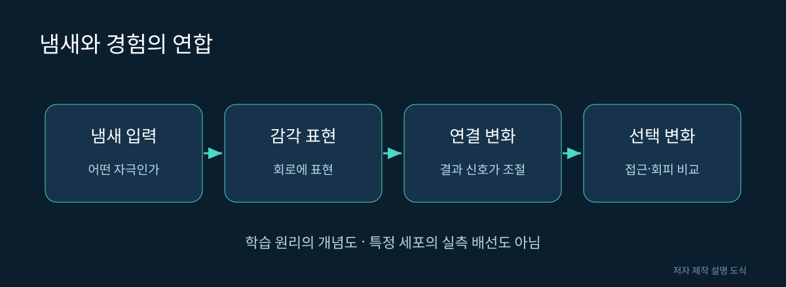

# 09. 냄새, 보상, 기억은 어떻게 연결되는가

같은 냄새라도 과거에 어떤 일이 뒤따랐는지에 따라 접근하거나 피할 수 있습니다. 이것이 연합 학습을 이해하는 가장 쉬운 출발점입니다. 냄새가 단순한 감각에서 앞으로 일어날 일을 알려 주는 단서가 되는 것입니다.

## 버섯체라는 이름

버섯체는 곤충 뇌의 학습 연구에서 자주 등장하는 구조입니다. 초파리에서는 Kenyon 세포, 버섯체 출력 뉴런(MBON), 도파민 뉴런(DAN) 등의 관계를 통해 냄새와 결과의 연합을 연구합니다. 이름은 연구 대상에 붙인 주소라고 생각하면 됩니다.

| 구성 | 이 장에서의 역할 설명 | 피해야 할 오해 |
|---|---|---|
| 감각 표현 | 어떤 냄새인지 구분할 단서 | 냄새마다 세포 하나만 있음 |
| Kenyon 세포 | 감각 정보를 조합해 표현 | 문장을 이해하는 언어 모델 |
| MBON | 학습된 가치와 행동 선택에 관여 | 몸의 모든 근육을 직접 지휘 |
| DAN | 학습 관련 변화를 조절 | 언제나 행복만 전달 |

이 표는 회로를 이해하기 위한 입문 설명이며, 모든 세포 유형의 기능을 빠짐없이 나열한 것은 아닙니다.

그림 09. 냄새와 경험의 연합. 저자 제작 SVG 설명 도식. 실제 신경 구조의 측정 이미지가 아니다.

## 같은 자극과 다른 결과를 비교한다

가상의 실험에서 냄새 A 뒤에 먹이를 제공하고 냄새 B 뒤에는 아무 결과도 주지 않았다고 해봅시다. 나중에 A 쪽으로 더 많이 이동한다면 연합 학습의 후보 증거가 됩니다. 하지만 처음부터 A를 좋아했을 수 있으므로 훈련 전 선호도와 대조군을 함께 비교해야 합니다.

훈련을 하지 않은 집단, 순서를 바꾼 집단, 다른 냄새를 사용한 집단을 비교하면 설명이 더 단단해집니다. “훈련 후 달라졌다”보다 “다른 원인을 통제한 뒤에도 달라졌다”가 강한 주장입니다.

## 지도에 기억 내용이 적혀 있을까

고정한 표본의 연결 지도를 보고 그 초파리가 언제 어느 냄새를 경험했는지 그대로 읽을 수는 없습니다. 기억에는 연결의 상태와 변화 규칙 등이 관련되므로 구조 자료만으로 학습 과정을 완전히 복원할 수 없습니다.

도파민도 하나의 감정 이름으로 번역하면 곤란합니다. 세포 유형과 자극의 시점에 따라 학습 효과가 달라질 수 있다는 연구가 있습니다. “도파민을 넣으면 똑똑해진다”는 식의 표현은 이런 차이를 없애 버립니다.

## 기억의 지속 시간도 질문이다

훈련 직후의 선호 변화와 시간이 지난 뒤의 선호 변화는 같은 결과가 아닙니다. 관찰 시점을 기록하지 않으면 어떤 종류의 유지 효과를 봤는지 알 수 없습니다. 같은 과제를 반복했는지, 다른 자극을 중간에 경험했는지도 중요합니다.

예를 들어 가상 결과에서 훈련 직후에는 A를 선택했지만 다음 관찰에서는 선호가 약해졌다고 해봅시다. 이를 단순히 “모델이 고장 났다”고 부르기 전에 기억의 감소를 구현했는지, 입력 조건이 변했는지, 학습 규칙이 계속 적용되는지 확인해야 합니다.

## 고정된 모델에 학습을 기대할 때의 문제

계산 규칙에 가중치 갱신이나 상태 유지가 없다면 반복 실행만으로 새로운 기억이 생긴다고 가정할 수 없습니다. 자극을 여러 번 주었다는 사실과 모델이 그 경험을 저장했다는 사실은 다릅니다.

실행 뒤 결과가 달라졌다면 무작위 초기값 때문인지, 내부 상태가 남았기 때문인지, 실제 학습 변수가 바뀌었기 때문인지 구분합니다. 저장된 값과 갱신 규칙을 확인해야 “학습했다”는 표현이 구체적인 의미를 갖습니다.

## AI와 비교하는 방법

AI의 보상 신호와 생물의 조절 신호는 비교해 볼 만한 개념입니다. 그러나 같은 단어를 쓴다고 구현이 같지는 않습니다. 프로그램이 정한 점수, 생물의 세포 활동, 관찰자가 판단한 좋은 행동을 서로 구분해야 합니다.

출처: [Aso 등, MBON과 행동 선택](https://elifesciences.org/articles/04580), [Aso·Rubin, 세포 유형별 기억 갱신](https://elifesciences.org/articles/16135v1). 냄새 A·B 실험은 교육용 가정입니다.
