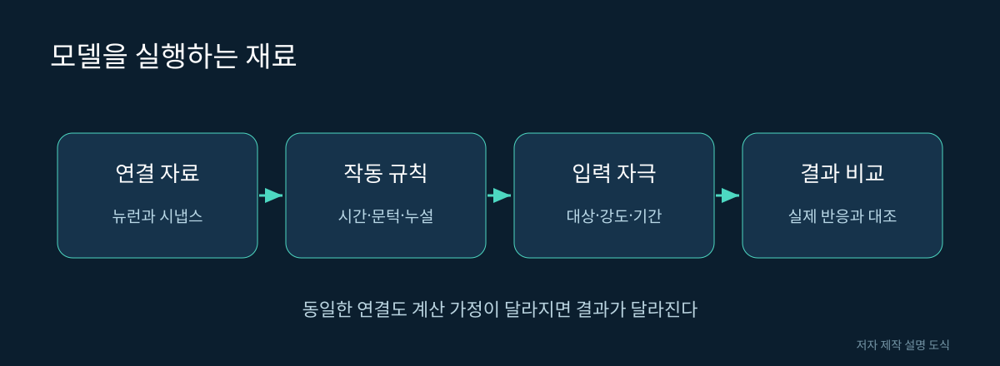

# 10. 연결 지도를 컴퓨터에서 실행하기

지도 위에 차를 그린다고 교통 시뮬레이션이 되는 것은 아닙니다. 차량이 어떻게 가속하고, 신호를 만나면 어떻게 멈추는지 규칙이 필요합니다. 뇌도 연결 목록과 뉴런의 작동 규칙을 합쳐야 시간에 따른 활동을 계산할 수 있습니다.

## 세 가지 재료

| 재료 | 입력 예시 | 모델 제작자가 정하는 것 |
|---|---|---|
| 구조 | 뉴런 식별자와 연결 | 포함할 세포와 연결 기준 |
| 동역학 | 입력을 받고 반응하는 규칙 | 시간 상수·문턱값·지연 |
| 실험 조건 | 어느 세포에 어떤 자극을 주는가 | 자극 강도·기간·측정 대상 |

구조를 실제 자료에서 가져와도 나머지 값은 추정하거나 단순화할 수 있습니다. 그러므로 “실제 연결 자료를 썼다”는 말만으로 생물과 완전히 같다고 판단할 수 없습니다.

그림 10. 모델을 실행하는 재료. 저자 제작 SVG 설명 도식. 실제 신경 구조의 측정 이미지가 아니다.

## 새는 물통으로 이해하는 LIF

LIF는 leaky integrate-and-fire의 줄임말입니다. 작은 구멍이 있는 물통에 물을 넣는 상황을 떠올려 보세요. 물은 입력에 해당하고 수위는 뉴런 상태에 해당합니다. 시간이 지나면 물이 조금씩 빠지고, 정해진 높이를 넘으면 신호를 보낸 뒤 수위를 낮춥니다.

이 비유는 계산 규칙을 이해하기 위한 것입니다. 실제 뉴런 안에 물이 찬다는 뜻도, 모든 초파리 뉴런이 동일한 문턱 규칙으로 작동한다는 뜻도 아닙니다. 등급성 신호 등 세포의 다양성을 하나의 단순 모델이 모두 담지는 못합니다.

가상의 숫자로 한 번 계산해 봅시다. 현재 상태가 0.5이고, 한 단계 후 80%가 남으며 입력 0.3을 더하면 새 상태는 0.7입니다. 문턱이 1.0이라면 아직 신호를 내보내지 않습니다. 이 계산을 여러 세포에서 반복하고 출력이 다음 입력으로 전달되도록 연결합니다. **0.5·0.8·0.3은 학습용 값이며 초파리에서 측정한 값이 아닙니다.**

## 논문 모델을 읽는 순서

Shiu 등의 공개 저장소는 초파리 뇌의 LIF 모델을 제공합니다. 처음부터 모든 코드를 읽을 필요는 없습니다. README에서 모델 목적을 읽고, 논문의 입력 자극과 출력 측정 대상을 찾아보세요. 그 뒤 어떤 결과를 실제 실험과 비교했는지 살펴보면 됩니다.

| 확인 질문 | 기록할 내용 |
|---|---|
| 어떤 데이터를 썼나 | 표본·버전·포함 세포 |
| 무엇을 고정했나 | 연결·가중치·전달물질 추정 |
| 무엇을 조절했나 | 입력 강도·뉴런 매개변수 |
| 무엇을 맞혔나 | 특정 감각운동 반응 |
| 무엇을 검증하지 않았나 | 다른 행동·학습·의식 등 |

## 오류가 나면 계산 단위를 살펴본다

한 단계가 1밀리초인 모델과 1초인 모델에 같은 입력 값을 넣으면 전혀 다른 결과가 나올 수 있습니다. 자극 강도의 단위, 시간 단위, 가중치의 해석을 먼저 확인하세요. 숫자만 복사하면 모델의 의미가 바뀔 수 있습니다.

연결의 방향도 자주 혼동하는 부분입니다. 표의 행이 입력 세포인지 출력 세포인지 확인하지 않으면 그래프 전체를 반대로 사용할 수 있습니다. 처음에는 세포 두세 개의 작은 가상 회로로 입력이 예상한 방향으로 전달되는지 이해한 뒤 큰 자료를 읽는 편이 좋습니다.

## 작은 모델을 해석하는 기록지

| 항목 | 적을 내용 |
|---|---|
| 시작 상태 | 모든 값이 0인가, 무작위인가 |
| 반복 간격 | 한 번 계산할 때 얼마나 시간이 지나는가 |
| 입력 | 어느 세포에 언제 들어가는가 |
| 출력 | 신호 횟수인가, 평균 상태인가 |
| 비교 | 자극이 없는 경우와 무엇이 달라지는가 |

이 표는 실행 결과를 과학적 관찰로 옮기는 연결 고리입니다. 수천 개 점이 반짝이는 애니메이션을 보고 “뇌가 활동한다”고 말하는 것보다 무엇을 계산해 어떤 값이 변했는지 적는 편이 더 많은 정보를 줍니다.

## ‘실행됨’과 ‘재현됨’

프로그램이 오류 없이 끝나는 것은 실행 성공입니다. 논문과 같은 조건에서 같은 경향을 얻는 것은 재현의 일부입니다. 생물의 행동을 새로운 조건에서도 예측하는 것은 더 강한 검증입니다. 이 세 단계를 한 번에 성공했다고 기록하지 마세요.

출처: [공식 모델 저장소](https://github.com/philshiu/Drosophila_brain_model), [Shiu 등 논문](https://doi.org/10.1038/s41586-024-07763-9). 본 책에서는 이 대규모 모델을 실행해 검증한 것으로 주장하지 않습니다.
