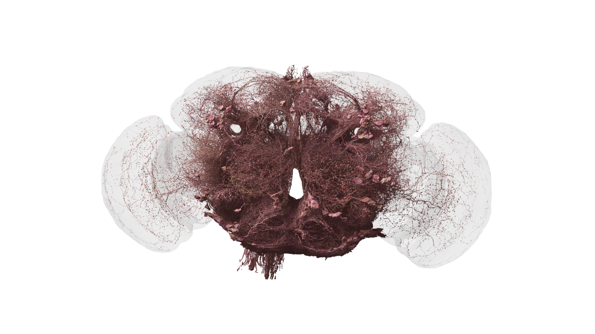

# 12. 뇌 모델에 몸과 환경을 붙이기

가상 초파리가 걷는 영상은 이해하기 쉽지만, 그 안에는 여러 모델이 결합되어 있습니다. 신경 활동을 계산하는 부분, 근육이나 관절의 움직임을 계산하는 부분, 바닥과 충돌을 계산하는 부분, 감각을 다시 만들어 주는 부분이 필요합니다.

## 몸은 출력 장치이면서 입력의 원천이다

발이 땅에 닿으면 다음 움직임이 달라집니다. 몸이 회전하면 눈에 들어오는 장면도 달라집니다. 따라서 뇌에서 몸으로만 신호가 내려가는 일방통행으로 설명하기 어렵습니다.

| 구성 | 질문 | 잘못 설정했을 때 |
|---|---|---|
| 감각 | 무엇을 관찰하는가 | 실제로는 못 보는 정보를 받음 |
| 제어기 | 어떤 명령을 내리는가 | 불가능한 움직임을 지시함 |
| 몸 | 어떤 관절과 힘을 갖는가 | 생물과 다른 운동 발생 |
| 환경 | 바닥·공기·장애물은 어떤가 | 쉬운 조건에서만 성공 |
| 피드백 | 결과가 어떻게 돌아오는가 | 실수에 적응하지 못함 |

그림 12. 뇌에서 신경삭 방향으로 정보를 전달하는 하행 뉴런. 몸 모델과 연결할 신호를 생각하는 참고 자료다. 데이터: FlyWire.ai. 렌더링: Philipp Schlegel (University of Cambridge/MRC LMB). [원본 갤러리](https://flyconnecto.me/media/) · [CC BY 4.0](https://creativecommons.org/licenses/by/4.0/). 제공된 1920×1080 파일을 수정 없이 수록.

## Flybody를 이해하는 위치

Flybody는 MuJoCo 기반 초파리 몸 모델과 운동 과제를 제공하는 공개 프로젝트입니다. 몸 모델은 신경 연결 지도와 역할이 다릅니다. 두 프로젝트를 함께 쓴다면 어떤 신경 출력을 어떤 관절 명령으로 변환했는지 설명해야 합니다.

예를 들어 신경 활동의 평균을 “전진 속도”로 바꾸고, 별도 제어기가 다리 움직임을 만든다면 전진 선택과 보행 생성의 기여를 나눠 평가해야 합니다. 이 연결 부품은 사소한 접착제가 아니라 결과에 큰 영향을 주는 설계입니다.

## 최근 시연을 읽는 방법

Eon의 2026년 3월 기술 설명은 뇌 모델과 몸을 결합한 작업을 소개하면서 구현된 범위와 아직 구현되지 않은 행동을 함께 설명합니다. 이런 개발팀 설명은 유용한 1차 자료이지만, 독립적으로 검증된 범위와 구별해서 인용해야 합니다.

영상에 없는 행동까지 성공했다고 확대하지 마세요. 짧은 평지 보행 영상은 거친 지면, 장시간 학습, 모든 감각 조건에서의 성공을 증명하지 않습니다.

## 평지 성공을 거친 지면으로 옮기면

가상의 제어기가 평평한 바닥에서 일정한 간격으로 다리를 움직인다고 해봅시다. 낮은 턱을 만나면 발이 예상 위치에 닿지 않을 수 있습니다. 미리 정한 박자만 반복하는 제어기와 접촉 정보를 받아 보정하는 제어기의 차이가 드러나는 순간입니다.

이런 비교에서는 바닥을 바꾼 것 외에 제어기와 시작 조건을 가급적 같게 유지합니다. 성공한 영상 하나보다 여러 초기 자세에서의 실패 비율과 회복 시간을 기록하면 제어 방식의 특성을 더 잘 알 수 있습니다.

## 실제 로봇으로 옮기는 비용

물리 시뮬레이터는 마찰과 관절을 수학적으로 표현합니다. 실제 장치는 센서 잡음, 통신 지연, 부품 오차가 있습니다. 가상 환경의 성공을 실제 로봇의 성공으로 바로 발표하면 이 차이를 생략합니다.

프로젝트를 소개할 때는 “시뮬레이션 결과”인지 “실제 장치에서 측정한 결과”인지 첫 문단에 적어 주세요. 실험 무대가 달라진다는 것은 기술의 가치를 깎는 말이 아니라 다음 검증 단계가 무엇인지 알려 주는 말입니다.

## 독자가 만들 수 있는 평가표

영상을 보며 “자연스럽다”만 적는 대신 시작 자세, 바닥, 자극, 성공 기준을 적어 보세요. 그리고 같은 조건을 여러 번 반복했는지, 실패 영상도 공개했는지 확인합니다. 시각적 인상과 측정 가능한 결과를 함께 기록하는 방법입니다.

출처: [Flybody 공식 저장소](https://github.com/TuragaLab/flybody), [전신 물리 시뮬레이션 논문](https://doi.org/10.1038/s41586-025-09029-4), [Eon 개발팀 기술 설명](https://eon.systems/updates/embodied-brain-emulation).
