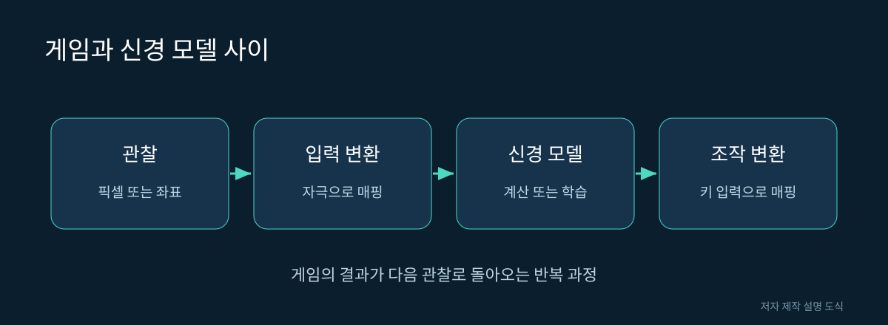

# 13. ‘초파리 뇌가 게임을 한다’는 말을 해석하기

화면 속 캐릭터가 움직이면 누구나 게임을 한다고 말합니다. 연구적으로는 그 움직임이 어떤 입력과 규칙에서 나왔는지 더 자세히 살펴봐야 합니다. 실제 신경 연결을 사용했더라도 게임과 연결하는 변환 방식에 따라 의미가 달라집니다.

## 네 층으로 나누어 보기

| 층 | 가능한 구현 | 해석의 쟁점 |
|---|---|---|
| 관찰 | 화면 픽셀·물체 좌표·정답 정보 | 사람보다 유리한 정보를 받는가 |
| 변환 | 밝기를 뉴런 입력으로 매핑 | 연구자가 얼마나 설계했는가 |
| 계산 | 고정 모델·학습된 연결·별도 정책 | 어느 부분이 행동을 결정하는가 |
| 행동 | 활동을 키 입력으로 변환 | 외부 제어 규칙이 얼마나 있는가 |

이 표는 특정 온라인 시연을 분석한 결과가 아니라, 독자가 앞으로 시연을 검토하기 위한 틀입니다.

그림 13. 게임과 신경 모델 사이. 저자 제작 SVG 설명 도식. 실제 신경 구조의 측정 이미지가 아니다.

## 같은 영상과 다른 내부 원리

가상의 미로에서 캐릭터가 출구로 향했다고 해봅시다. 화면 전체를 보고 판단했을 수도 있고, 출구까지의 방향 숫자를 미리 받았을 수도 있습니다. 두 경우의 화면은 비슷해도 해결한 문제의 난이도는 다릅니다.

또 다른 경우에는 신경망 출력이 오른쪽·왼쪽 중 하나를 고르고 별도 코드가 충돌을 피할 수 있습니다. 이때 성공을 전부 신경망의 공로로 돌리면 외부 코드의 역할이 사라집니다. 반대로 외부 변환이 있다는 이유만으로 프로젝트가 무가치한 것도 아닙니다. 기여를 정확히 기술하면 됩니다.

## 학습 여부를 확인한다

고정 연결에서 반응만 계산하는 모델과 시행착오를 통해 가중치를 바꾸는 모델은 다릅니다. 원래 연결을 초기값으로 사용했지만 훈련 중 대부분이 바뀌었다면 최종 모델을 “생물의 배선을 그대로 실행했다”고 설명하기 어렵습니다.

기록할 항목은 초기 연결, 고정한 요소, 학습한 요소, 보상 규칙, 학습 시간입니다. 성공 화면뿐 아니라 학습 곡선과 새로운 맵에서의 성능을 보면 일반화를 평가하는 데 도움이 됩니다.

## 대조군을 하나씩 추가한다

가상의 게임 제어 프로젝트를 평가한다면 먼저 무작위 키 입력과 비교할 수 있습니다. 그보다 좋다면 단순한 규칙 기반 제어기와 비교합니다. 이어서 같은 뉴런 수를 가진 임의 연결 모델과 비교하면 생물 배선의 기여를 더 구체적으로 물을 수 있습니다.

| 비교 대상 | 답하려는 질문 |
|---|---|
| 무작위 조작 | 우연한 움직임보다 나은가 |
| 단순 규칙 | 복잡한 모델이 꼭 필요한가 |
| 임의 연결 모델 | 실제 연결 형태의 이점이 있는가 |
| 새 맵 | 훈련 조건 밖에서도 되는가 |

점수가 높은 조건만 골라 공개하면 결과가 실제보다 좋아 보일 수 있습니다. 반복 횟수, 평균과 편차, 실패 조건을 함께 확인해야 합니다. 한 번의 성공과 안정적인 정책은 같은 성취가 아닙니다.

영상이 재미있다는 평가와 과학적 기여가 크다는 평가는 공존할 수 있지만 기준은 다릅니다. 교육용 시연이라면 그 목적을 분명히 하고, 생물학적 발견이라고 주장한다면 회로에 관한 새로운 검증이 무엇인지 설명해야 합니다.

## 정확한 소개문 연습

과장된 문장: “초파리의 정신을 컴퓨터에 넣어 게임을 시켰다.”

더 정확한 가상 소개문: “초파리 커넥톰을 구조로 사용한 계산 모델의 출력을 게임 조작에 연결했다. 감각 변환과 조작 규칙은 연구자가 설계했으며, 이 결과만으로 의식이나 생물 전체의 재현을 주장하지 않는다.”

이 장에서는 검증하지 않은 개별 게임 시연의 성능을 확정하지 않습니다. 블로그에 시연을 소개할 때는 해당 프로젝트 원문, 코드 버전, 실제로 확인한 결과를 추가해야 합니다.

참고: [뇌 계산 모델의 원본 구현](https://github.com/philshiu/Drosophila_brain_model), [몸과 행동 모델의 원본 구현](https://github.com/TuragaLab/flybody).
