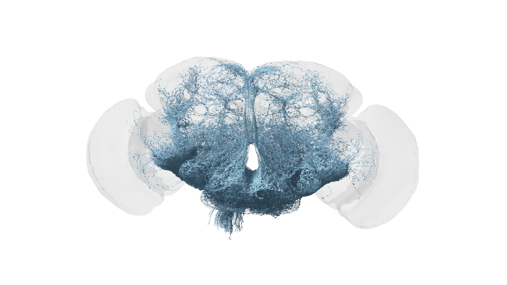

# 14. 인간 뇌 연구로 이어지는 길

초파리 뇌 지도가 만들어졌다면 다음에는 인간 뇌도 같은 방법으로 그리면 될까요? 방향은 비슷할 수 있지만 단순히 컴퓨터를 더 오래 돌리는 문제만은 아닙니다. 표본 처리, 영상 규모, 교정 비용, 기능 해석, 개인 정보와 윤리 문제가 함께 커집니다.

## 크기보다 먼저 비교할 것

뉴런 수는 규모를 짐작하게 하지만 연구 난이도를 단독으로 결정하지 않습니다. 긴 연결이 잘리지 않도록 표본 범위를 정하고, 서로 다른 세포를 구별하고, 측정 오류가 어디까지 영향을 미치는지도 확인해야 합니다.

| 비교 항목 | 초파리에서 배우는 것 | 큰 뇌로 넓힐 때의 질문 |
|---|---|---|
| 촬영 | 단면을 정렬하는 방법 | 필요한 공간·시간은 얼마인가 |
| 재구성 | 가지를 이어 붙이는 방법 | 교정 비용을 줄일 수 있는가 |
| 주석 | 유형을 일관되게 분류 | 개체 간 대응이 가능한가 |
| 기능 | 연결과 실험을 연결 | 연구 대상과 실험 조건이 가능한가 |
| 공유 | 공동 데이터 기반 만들기 | 권리와 접근 조건은 무엇인가 |

그림 14. 신경삭에서 뇌 방향으로 정보를 전달하는 초파리 상행 뉴런. 인간 신경계를 그린 그림이 아니다. 데이터: FlyWire.ai. 렌더링: Philipp Schlegel (University of Cambridge/MRC LMB). [원본 갤러리](https://flyconnecto.me/media/) · [CC BY 4.0](https://creativecommons.org/licenses/by/4.0/). 제공된 1920×1080 파일을 수정 없이 수록.

## 일반 원리와 직접 대응

여러 생물에서 감각 통합, 억제와 흥분의 상호작용, 경험에 따른 변화 같은 질문을 연구할 수 있습니다. 그러나 초파리 세포 이름을 인간 뇌 부위로 그대로 치환하면 안 됩니다. 비슷한 문제를 푸는 회로가 진화적으로나 구조적으로 같은 회로인지 별도로 살펴봐야 합니다.

비유하면 두 도시 모두 교통 신호를 사용하지만 도로의 모양과 운영 규칙은 다를 수 있습니다. 한 도시에서 배운 분석법을 다른 도시에 적용할 수 있어도 한 지도를 그대로 복사해서 쓸 수는 없습니다.

## 질병 모델의 주장 범위

가상의 모델에서 연결 일부를 제거했더니 활동이 감소했다고 합시다. 이것이 곧 특정 인간 질환의 재현은 아닙니다. 제거 규칙이 실제 병리와 어떻게 대응하는지, 결과가 다른 설명으로도 나타나는지 확인해야 합니다.

신경계 모델은 가설을 만들고 실험을 설계하는 데 기여할 수 있습니다. 진단·치료 효과는 별도의 근거가 필요합니다. 이 책은 임상적인 효능을 다루지 않으며, 연구 가능성을 의료 성과로 바꾸어 표현하지 않습니다.

## 지도 규모와 기능 설명력은 따로 성장한다

더 넓은 영역을 그릴 수 있게 되는 것과 더 정확히 기능을 예측하게 되는 것은 관련되지만 동일한 진척도는 아닙니다. 큰 지도에 활동 정보가 부족할 수도 있고, 작은 회로에서는 정교한 실험으로 특정 계산을 잘 설명할 수도 있습니다.

뉴스를 비교할 때 “어느 쪽이 더 크다”와 “어느 쪽이 어떤 기능을 더 잘 설명한다”를 다른 칸에 적으세요. 크기가 작은 연구도 특정 질문에 관해서는 매우 강한 증거를 제공할 수 있습니다.

## 한계가 다음 연구 질문이 된다

개체가 하나뿐이라는 한계는 더 많은 표본 비교로 이어집니다. 정적인 지도라는 한계는 활동 기록과 연결하는 질문으로 이어집니다. 몸이 없는 모델이라는 한계는 감각과 운동을 포함하는 모델로 이어집니다.

이렇게 한계를 후속 질문으로 바꾸면 “아직 인간 뇌를 못 만들었으니 의미 없다”는 평가도 피할 수 있습니다. 무엇을 가능하게 했고 다음에 무엇을 검증해야 하는지 구체적으로 말하는 것이 연구 성과를 이해하는 균형 잡힌 방식입니다.

## 독자에게 남는 기술

인간 뇌의 전체 지도가 언제 완성될지 예언하는 것보다 현재 성과를 정확히 읽는 능력이 오래갑니다. 어느 범위를 재구성했고, 어떤 기능을 실험했으며, 무엇이 아직 가정인지 구별하면 다음 발표도 스스로 평가할 수 있습니다.

출처: [NIH의 전체 초파리 뇌 지도 설명](https://www.nih.gov/news-events/nih-research-matters/complete-wiring-map-adult-fruit-fly-brain). 도시·질병 모델 사례는 설명용 가정입니다.
