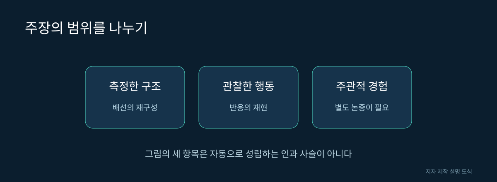

# 15. 의식과 복제에 대해 어디까지 말할 수 있을까

가상 생물이 자극을 피하면 “무서워한다”고 말하고 싶어집니다. 일상적인 표현으로는 자연스럽지만 과학 설명에서는 관찰과 해석을 구분해야 합니다. 화면에서 확인한 것은 자극 뒤의 움직임이지 주관적 경험 자체가 아닙니다.

## 세 가지 질문

| 질문 | 필요한 증거 | 그것만으로 결론 낼 수 없는 것 |
|---|---|---|
| 반응을 재현했는가 | 자극과 행동의 비교 | 의식의 존재 |
| 내부 구조를 재현했는가 | 연결·상태·규칙의 대응 | 원래 개체와의 동일성 |
| 경험이 있는가 | 명확한 개념과 검증 가능한 기준 | 영상의 자연스러움만으로 판단 |

의식이 있다고 단정하는 것과 없다고 단정하는 것 모두 근거가 필요합니다. 계산 모델의 기능적 성공을 설명하면서 의식 문제에 대해서는 결론을 유보할 수 있습니다. 이는 연구 결과를 깎아내리는 태도가 아니라 주장 범위를 지키는 태도입니다.

그림 15. 주장의 범위를 나누기. 저자 제작 SVG 설명 도식. 실제 신경 구조의 측정 이미지가 아니다.

## 지도와 개체의 차이

건물 설계도를 복사해도 그 건물 안에서 있었던 사람들의 경험까지 옮겨지는 것은 아닙니다. 비슷하게 연결 지도를 복사했다는 사실만으로 한 동물의 생애와 기억이 그대로 옮겨졌다고 말할 수 없습니다.

물론 이 비유가 뇌와 건물이 같다는 뜻은 아닙니다. 어떤 정보가 실제로 측정되어 저장되었는지를 먼저 묻자는 뜻입니다. 측정하지 않은 정보를 모델이 보유한다고 가정하려면 별도의 근거가 있어야 합니다.

## ‘디지털 쌍둥이’라는 표현

이 표현을 사용할 때는 닮은 기준을 써야 합니다. 몸의 외형을 닮았는지, 특정 움직임을 닮았는지, 신경 반응을 예측하는지에 따라 의미가 다릅니다. 독자가 무엇을 기대해야 하는지 캡션과 소개문에 적어 주세요.

“일부 보행 조건에서 동작을 비교하는 모델”은 구체적인 설명입니다. “살아 있는 초파리를 완전히 복제했다”는 문장은 훨씬 넓은 주장이므로 그만큼 많은 근거를 요구합니다.

## 주장과 근거를 분리해 써 보기

가상의 영상에서 초파리 모형이 어두운 물체를 피했습니다. 관찰 문장은 “물체가 커지는 자극 뒤에 이동 방향이 바뀌었다”입니다. 기능 해석은 “이 모델이 특정 회피 반응을 구현한다”입니다. 경험에 관한 해석은 “모델이 두려움을 느꼈다”입니다.

세 문장은 같은 영상을 보고 나올 수 있지만 필요한 근거는 다릅니다. 관찰은 영상이나 기록으로 확인할 수 있고, 기능은 조건을 통제한 시험으로 평가할 수 있습니다. 마지막 문장은 추가적인 개념 정의와 논증을 요구합니다.

## 독자가 오해하기 쉬운 표현

| 표현 | 함께 써야 하는 설명 |
|---|---|
| 살아 움직인다 | 어떤 계산과 물리 모델로 움직이는가 |
| 기억한다 | 어떤 상태가 저장되고 얼마나 유지되는가 |
| 스스로 결정한다 | 가능한 행동과 선택 규칙은 무엇인가 |
| 뇌를 복제했다 | 어떤 구조·기능을 어느 범위까지 재현했는가 |

일상적인 말을 모두 금지할 필요는 없습니다. 다만 처음 사용할 때 그 글에서 어떤 의미로 쓰는지 설명하면 독자가 과학적 주장과 생생한 비유를 구분할 수 있습니다.

## 설명의 책임

연구 영상과 생성 이미지를 혼합할 때도 구분이 필요합니다. 생성한 뇌 그림은 개념 설명에 도움이 될 수 있지만 그 선 하나하나가 실측 신경 연결을 뜻하지 않습니다. 독자가 실제 데이터라고 믿을 수 있는 위치에는 자료 종류를 명확히 써야 합니다.

이 장의 핵심은 의식의 최종 정의를 제시하는 것이 아니라, 관찰한 결과와 철학적 해석을 나누어 말하는 방법입니다. 본 책은 어떤 초파리 시뮬레이터의 의식을 입증하거나 부정하지 않습니다.

참고: [계산 모델의 검증 범위를 확인할 수 있는 연구](https://doi.org/10.1038/s41586-024-07763-9), [가상 몸 모델 연구](https://doi.org/10.1038/s41586-025-09029-4). 의식에 관한 구분과 비유는 저자의 논점 정리입니다.
