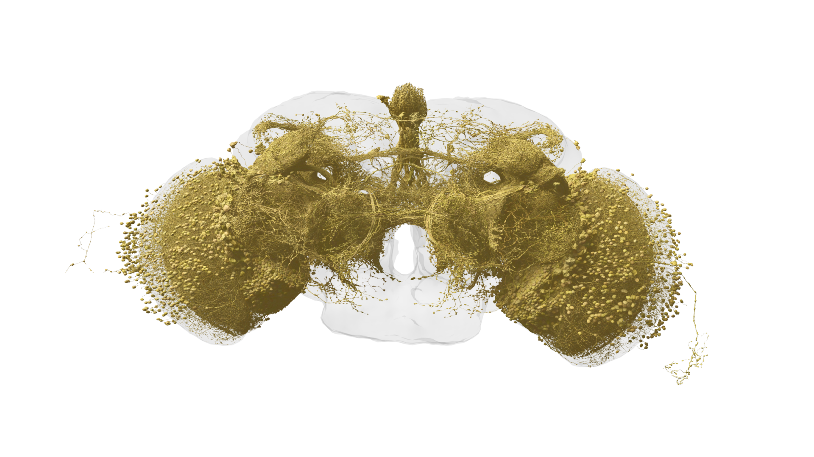

# 16. 실습: 브라우저로 실제 뇌 지도 탐험하기


이 실습의 목표는 코드를 설치하지 않고 실제 데이터에서 세포 하나와 연결 상대를 찾아 관찰 기록을 만드는 것입니다. 성공 기준은 멋진 화면을 띄우는 데 그치지 않습니다. 다른 사람이 같은 자료를 다시 찾을 수 있게 주소와 버전을 기록해야 합니다.

## 준비

데스크톱 브라우저와 메모할 문서를 준비합니다. 화면 구성이 바뀔 수 있으므로 버튼의 위치보다 기능 이름을 기준으로 찾습니다. 로그인이나 그래픽 성능 문제로 3D 뷰어를 사용할 수 없다면 공식 갤러리와 표 형태의 정보를 이용하는 경로도 있습니다.

1. [Codex](https://codex.flywire.ai/)를 엽니다.
2. 데이터셋 선택이 있으면 사용할 자료를 확인합니다. 이 책의 FlyWire 그림은 성체 암컷 뇌 자료입니다.
3. [FAQ](https://codex.flywire.ai/faq)에서 현재 데이터와 다운로드 자료의 관계를 읽습니다.
4. 메모 첫 줄에 방문 날짜, 데이터셋, 표시된 버전을 적습니다.

Codex의 현재 다운로드 자료는 출판 당시 고정 자료와 다를 수 있다는 공식 안내가 있습니다. 화면에 버전이 명확히 보이지 않으면 임의의 번호를 적지 말고 “확인되지 않음”으로 남겨 두세요.



그림 16. 시각계와 중앙 뇌를 연결하는 투사 뉴런. 뷰어에서 관찰할 구조의 참고 이미지이며 실습 화면 캡처는 아니다. 데이터: FlyWire.ai. 렌더링: Philipp Schlegel (University of Cambridge/MRC LMB). [원본 갤러리](https://flyconnecto.me/media/) · [CC BY 4.0](https://creativecommons.org/licenses/by/4.0/). 제공된 1920×1080 파일을 수정 없이 수록.

## 실습 A: 유형 하나에서 세포 하나로

탐색 메뉴에서 Cell Types 또는 세포 유형 관련 항목을 찾습니다. 관심 있는 유형 하나를 선택하고 해당 세포 목록이나 상세 정보로 들어갑니다. 시각계에 관심이 있다면 유형 이름에 T4 또는 T5가 있는지 탐색해 볼 수 있습니다. 검색 결과가 없으면 분류표에서 실제 제공하는 이름을 먼저 확인하세요.

선택한 세포의 식별자, 유형, 영역을 기록합니다. 어떤 이름이 여러 세포를 묶는 분류명이고 어떤 번호가 하나의 세포를 가리키는지 구분하는 것이 목표입니다. 번호가 길어도 외울 필요는 없습니다.

## 실습 B: 연결 방향 읽기

세포 상세 화면의 입력·출력 또는 연결 상대 정보를 찾습니다. 입력 상대와 출력 상대를 각각 하나씩 기록합니다. 시냅스 수와 정렬 기준도 표시되는 범위에서 적습니다.

| 기록 항목 | 작성 예 |
|---|---|
| 선택한 세포 | 화면에 표시된 식별자를 복사 |
| 유형 | 실제 표기 이름 |
| 입력 상대 | 상대 식별자와 표시된 수치 |
| 출력 상대 | 상대 식별자와 표시된 수치 |
| 조건 | 표시 임계값·필터가 있으면 기록 |
| 근거 | 해당 상세 화면 URL |

이 표에는 실존 세포 번호를 지어 넣지 않았습니다. 직접 화면에서 확인한 값을 채워야 실습 결과가 됩니다.

## 실습 C: 그림과 표 비교하기

3D 보기 기능을 사용할 수 있다면 세포의 가지가 퍼지는 범위를 관찰합니다. 화면을 회전하며 평면에서 겹쳐 보이던 가지의 위치가 달라지는지 확인하세요. 표에서 확인한 연결을 단순한 선 겹침으로 대체해 판단하지 않습니다.

뷰어가 느리면 한 번에 보여 주는 세포 수를 줄이세요. 전체 뇌를 처음부터 모두 표시하는 것보다 선택한 세포 하나를 자세히 보는 것이 학습 목적에 맞습니다.

## 실습 D: MaleCNS로 범위 비교하기

[MaleCNS](https://male-cns.janelia.org/)의 Explore를 열고 Cell Type Explorer 또는 neuPrint로 이동합니다. 처음에는 파일 다운로드보다 재구성 범위와 세포 유형 설명을 읽습니다. 암컷 뇌와 수컷 중추신경계의 영역 차이를 한 문장으로 정리해 보세요.

| 문제 | 먼저 해볼 조치 |
|---|---|
| 결과가 없음 | 선택 데이터와 실제 유형명 확인 |
| 3D가 느림 | 선택 세포 수 줄이기 |
| 숫자가 논문과 다름 | 범위·버전·필터 비교 |
| 로그인이 필요함 | 본인 계정으로 진행하거나 공개 갤러리 이용 |
| 동일 세포를 못 찾음 | 버전 간 식별자 대응 여부 확인 |

## 선택 실습: 필터가 결과를 바꾸는가

연결 상대 화면에서 최소 시냅스 수나 다른 필터를 변경할 수 있다면, 변경 전후의 목록을 비교해 보세요. 화면에서 제공하지 않는 기능을 찾느라 오래 머무를 필요는 없습니다. 가능한 경우에만 진행합니다.

기록할 것은 필터 값, 상대 수의 변화, 목록에서 사라진 상대의 특징입니다. “연결이 약해졌다”라고 쓰기보다 “표시 기준을 바꾸자 목록에 포함된 상대가 줄었다”라고 적는 편이 정확합니다.

## 캡처를 공유할 때

뷰어 캡처를 자신의 블로그에 올릴 계획이라면 해당 화면과 데이터의 이용 조건을 별도로 확인합니다. 이 책의 갤러리 이미지 허용 조건이 모든 웹 화면에 자동으로 적용되지는 않습니다. 계정 이름 등 불필요한 개인 정보가 화면에 포함되지 않았는지도 살펴보세요.

공유 링크가 유지되지 않는 경우에는 데이터 이름과 세포 식별자를 텍스트로 함께 보관합니다. 스크린샷만 있으면 나중에 같은 대상을 찾기 어려울 수 있습니다. 이 기록이 다른 사람의 재확인과 자신의 후속 학습을 돕습니다.


## 실습 결과물

마지막으로 “관찰한 사실 두 문장, 아직 모르는 것 한 문장”을 적습니다. 예를 들어 입력 상대를 확인했다는 것은 사실이지만 그 세포가 어떤 감정을 만든다는 주장은 아닙니다. 본문에 실습 결과를 공유할 때도 이 형식을 사용하세요.

출처: [Codex 공식 FAQ](https://codex.flywire.ai/faq), [MaleCNS 공식 탐색 안내](https://male-cns.janelia.org/). 경로는 공식 안내를 바탕으로 작성했으며 로그인 이후의 전체 클릭 흐름을 직접 실행해 검증한 것은 아닙니다.

## 소스코드 따라 하기: 30분짜리 첫 실행

브라우저 탐색을 마쳤다면 공개 소스코드로 연결표를 읽어 볼 수 있습니다. 아래 절차는 “초파리 뇌를 AI로 복제”하는 과정이 아니라, 공개된 연결 자료를 내려받아 파일 구조와 작은 통계를 확인하는 입문 실습입니다. 한 단계가 끝날 때마다 화면에 오류가 없는지 확인하고 다음 단계로 넘어가세요.

### 1단계. 준비물 확인

다음 중 하나를 고릅니다.

| 선택 | 장점 | 단점 |
|---|---|---|
| Google Colab | 설치가 거의 없음 | 실행이 느리거나 세션이 끊길 수 있음 |
| 내 컴퓨터 + Conda | 파일과 환경을 오래 보관 | 처음 한 번 설치 필요 |
| 코드 없이 웹 화면 | 가장 쉬움 | 대량 표 계산은 어려움 |

처음이라면 저장소 README의 **Open in Colab** 버튼을 사용합니다. 로컬 설치를 선택한다면 Miniconda를 공식 사이트에서 설치한 뒤 터미널을 엽니다. 명령어의 `$` 기호는 입력하지 않습니다.

### 2단계. 저장소 복사

터미널에 다음을 한 줄씩 입력합니다.

```bash
git clone https://github.com/philshiu/Drosophila_brain_model.git
cd Drosophila_brain_model
```

`git: command not found`가 나오면 Git을 먼저 설치해야 합니다. 폴더가 이미 있다는 메시지가 나오면 같은 저장소를 다시 복사하지 말고, 기존 폴더로 이동합니다.

```bash
cd Drosophila_brain_model
git pull
```

### 3단계. 실행 환경 만들기

저장소 폴더 안에서 아래 명령을 입력합니다.

```bash
conda env create -f environment.yml
conda env list
conda activate <목록에서 environment.yml의 이름>
jupyter notebook example.ipynb
```

`<...>`를 꺾쇠까지 그대로 입력하지 말고, `conda env list`에 보이는 실제 환경 이름으로 바꿉니다. 브라우저에서 `example.ipynb`가 열리면 첫 번째 셀부터 순서대로 실행합니다. 셀 왼쪽의 재생 버튼을 눌러 한 셀씩 실행하며, 오류가 나면 다음 셀로 건너뛰지 않습니다.

### 4단계. 연결표의 모양 확인

노트북에 새 셀을 만들고 아래를 입력합니다.

```python
import pandas as pd

con = pd.read_parquet("Connectivity_783.parquet")
print(con.shape)
print(con.columns.tolist())
print(con.head(3))
```

화면에 행·열 개수, 열 이름, 앞의 세 행이 출력되면 성공입니다. 이 단계에서는 전체 뇌를 화면에 그리지 않습니다. 연결표를 읽는 데 필요한 `pyarrow`가 없다는 메시지가 나오면 노트북의 안내에 따라 설치하고 커널을 다시 시작합니다.

### 5단계. 연결 한 방향 세기

이 저장소 모델의 현재 연결표는 `Presynaptic_Index`와 `Postsynaptic_Index` 열을 사용합니다. 다음 코드는 실제 세포 ID가 아니라 표 안의 **행 번호**를 예로 듭니다.

```python
one_row = con.iloc[0]
pre = one_row["Presynaptic_Index"]
post = one_row["Postsynaptic_Index"]

print("첫 연결의 입력 인덱스:", pre)
print("첫 연결의 출력 인덱스:", post)
print("같은 입력에서 나가는 연결 수:",
      (con["Presynaptic_Index"] == pre).sum())
```

여기서 인덱스는 FlyWire ID와 다를 수 있습니다. 이 모델은 `Completeness_783.csv`의 행 순서를 Brian 시뮬레이터의 내부 번호로 바꾸어 사용합니다. 따라서 결과를 웹 화면의 세포 ID와 연결하려면 두 파일의 매핑과 저장소 코드를 함께 확인해야 합니다.

### 6단계. 작은 모델 실행 여부 판단

이제 `example.ipynb`의 기본 예제를 실행할 수 있습니다. 실행 전에 다음을 기록합니다.

```bash
git rev-parse HEAD
python --version
conda env export > environment-record.yml
```

시뮬레이션은 `model.py`의 `run_exp`가 입력 뉴런을 활성화하거나 침묵시키고 결과를 `results/` 아래 Parquet 파일로 저장하는 방식입니다. 첫 실행은 저장소가 제공하는 예제 그대로 두고, 실행 시간을 크게 늘리거나 입력 뉴런을 임의로 바꾸지 마세요. 원시 결과는 수 GB가 될 수 있습니다.

### 7단계. 결과 읽기와 기록

결과 파일이 생겼다면 다음처럼 행 수와 열 이름만 확인합니다.

```python
result = pd.read_parquet("results/example/<결과파일명>.parquet")
print(result.shape)
print(result.columns.tolist())
print(result.head())
```

보고서에는 다음 다섯 줄을 남깁니다.

1. 저장소 주소와 커밋
2. 연결 자료 파일명과 버전
3. 입력으로 사용한 세포 목록
4. 결과 파일명과 행·열 개수
5. 아직 확인하지 못한 것

프로그램이 끝났다는 사실은 생물학적 결론이 아닙니다. 특히 스파이크가 많이 나왔다는 이유만으로 “초파리가 생각했다”거나 “의식이 생겼다”고 쓰지 않습니다. 이 실습은 구조 자료를 코드로 읽고, 계산 규칙과 실험 조건을 분리해 기록하는 연습입니다.

### 문제가 생겼을 때의 순서

| 화면에 보이는 문제 | 먼저 할 일 |
|---|---|
| `conda`를 찾을 수 없음 | Miniconda 설치와 터미널 재시작 |
| 파일을 찾을 수 없음 | 현재 폴더가 저장소 루트인지 `pwd`·`dir`로 확인 |
| 열 이름 오류 | `con.columns.tolist()`를 먼저 출력 |
| 메모리 부족 | 전체 모델 대신 표의 앞부분만 읽고 실행 중단 |
| 실행이 너무 오래 걸림 | Colab·로컬 CPU 차이와 `n_proc` 확인 |
| 결과가 논문과 다름 | 데이터 버전·커밋·입력·매개변수 비교 |

이 절차에서 실제로 실행하지 않은 단계는 실행 완료라고 기록하지 않습니다. 이 책의 저자는 이 원고 작성 과정에서 대규모 모델의 수치 재현을 완료했다고 주장하지 않으며, 독자가 자신의 환경에서 실행한 기록을 별도로 남겨야 합니다.
