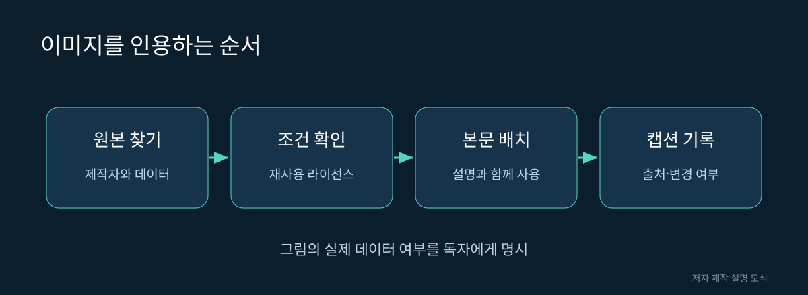

# 17. 과학 뉴스와 연구 그림을 읽는 방법

새로운 발표를 읽을 때 숫자와 영상부터 눈에 들어옵니다. 하지만 제대로 이해하려면 제목, 원문, 방법, 한계를 순서대로 연결해야 합니다. 이 장에서는 책과 블로그를 쓰는 독자가 사용할 수 있는 작은 편집 절차를 제안합니다.

## 발표의 종류

| 자료 | 알려 주는 것 | 따로 확인할 것 |
|---|---|---|
| 동료심사 논문 | 방법·분석·검증 | 실제 검증 조건 |
| 사전공개 논문 | 빠른 연구 공유 | 심사·수정 상태 |
| 연구팀 블로그 | 개발 과정과 의도 | 독립 검증 범위 |
| 코드 저장소 | 구현과 실행 방법 | 데이터·환경·버전 |
| 짧은 영상 | 특정 상황의 결과 | 실패·선별·외부 제어 |

어느 자료도 형식만으로 무조건 신뢰하거나 무시하지 않습니다. 구체적 주장에 맞는 증거가 있는지 살펴봅니다. 논문도 모든 조건을 검증하지 않으며, 코드가 공개되어도 자동으로 재현되는 것은 아닙니다.

그림 17. 이미지를 인용하는 순서. 저자 제작 SVG 설명 도식. 실제 신경 구조의 측정 이미지가 아니다.

## 숫자에 네 가지 꼬리표 붙이기

“연결 100만 개” 같은 문장을 만나면 무엇과 무엇 사이의 연결인지 확인합니다. 시냅스 접점 수인지, 방향이 있는 세포 쌍의 수인지, 임계값으로 걸러낸 그래프의 간선 수인지에 따라 의미가 달라집니다.

숫자 옆에는 단위, 범위, 버전, 출처를 붙입니다. 예를 들어 “뉴런 수 / 성체 암컷 뇌 / 논문 기준 / 원문 표”처럼 적으면 숫자만 떼어 재사용하는 실수를 줄일 수 있습니다.

## 이미지는 출처만 적으면 끝일까

공개 페이지에서 볼 수 있다는 사실과 재사용할 수 있다는 사실은 다릅니다. 그림의 제작자, 자료의 제공자, 페이지 운영자가 다를 수도 있습니다. 라이선스가 허용하는 범위를 확인하고 이미지별 별도 표시가 있는지도 읽어야 합니다.

이 책의 Fly Connectome 갤러리 이미지는 페이지에 표시된 CC BY 4.0 조건과 제작자 표기를 바탕으로 사용합니다. 원본을 잘라 쓰거나 색을 바꾸면 변경 사항도 캡션에 남깁니다. 자료 파일의 라이선스와 논문 그림의 라이선스를 자동으로 같다고 가정하지 않습니다.

## 캡션의 기본형

“무엇을 보여 주는지. 자료 종류와 표본. 제작자 및 데이터 출처. 원문 링크. 라이선스 링크. 변경 여부.”

실제 뇌 사진, 데이터의 3D 렌더링, 설명용 도식, 생성형 이미지 중 무엇인지 반드시 포함하세요. 독자가 그림의 증거 수준을 판단할 수 있어야 합니다.

## 한 문장 감사하기

가상의 기사에 “완전한 뇌를 복제해 어떤 게임이든 학습한다”라는 문장이 있다고 합시다. 이것을 세 주장으로 나눕니다. 완전한 뇌를 복제했는지, 실제로 학습 변수가 바뀌는지, 어떤 게임이든 성공하는지입니다. 각 주장에 다른 증거가 필요합니다.

| 주장 | 찾을 근거 |
|---|---|
| 완전한 복제 | 포함 범위·누락 요소·기능 비교 |
| 학습 | 갱신 규칙·훈련 전후·대조군 |
| 모든 게임 | 평가 과제 목록·새 조건·실패 사례 |

근거가 일부만 있으면 문장을 그 범위로 줄입니다. 예를 들어 특정 과제 하나에서 반응했다면 그 과제를 명시합니다. 검증되지 않은 일반화를 지우는 과정은 글을 약하게 만드는 것이 아니라 독자가 믿을 수 있는 범위를 명확히 하는 작업입니다.

## 수정 이력을 남긴다

새 논문이 나오거나 데이터가 갱신되면 기존 설명을 수정할 수 있습니다. 그때 확인 날짜와 수정 이유를 남기면 이전 독자가 무엇이 바뀌었는지 알 수 있습니다. Git 기록은 이런 변경을 보존하기 좋지만 독자를 위한 간단한 변경 안내도 도움이 됩니다.

## 블로그로 옮길 때

책의 설명을 짧게 바꾸더라도 핵심 한계를 삭제하지 않습니다. “특정 조건에서 반응 예측”을 “뇌를 완전히 재현”으로 줄이면 요약이 아니라 주장 변경입니다. 참고문헌과 이미지 크레딧도 함께 옮깁니다.

출처: [실제 사용한 이미지의 원본 갤러리](https://flyconnecto.me/media/), [CC BY 4.0 조건](https://creativecommons.org/licenses/by/4.0/). 본 장의 편집 절차는 저자의 권장 작업 방식입니다.
