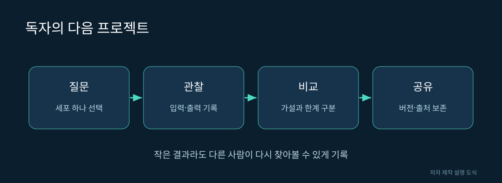

# 18. 앞으로 무엇을 지켜볼 것인가

초파리 뇌 연구의 가치는 커다란 숫자 하나에만 있지 않습니다. 구조, 활동, 행동을 더 정확히 연결하는 질문이 축적된다는 점이 중요합니다. 마지막 장에서는 새로운 발표가 나올 때 확인할 기준과 작은 개인 프로젝트를 정리합니다.

## 앞으로의 관찰 지점

| 연구 방향 | 기대할 수 있는 진전 | 확인할 질문 |
|---|---|---|
| 개체 간 비교 | 반복되는 구조와 차이 구분 | 표본이 얼마나 늘었는가 |
| 상태와 학습 | 고정 지도에 시간 정보 추가 | 변화가 직접 측정되었는가 |
| 몸과 환경 | 더 다양한 행동 조건 | 감각·운동 변환이 공개되는가 |
| 모델 검증 | 새로운 자극에 대한 예측 | 훈련에 쓰지 않은 조건인가 |
| 데이터 도구 | 누구나 탐색하고 재현 | 버전과 출처가 유지되는가 |

이 표는 성취된 결과의 목록이 아니라 앞으로 살펴볼 평가 기준입니다. 구체적인 완료 시점이나 인간 뇌 복제 일정을 예측하지 않습니다.

그림 18. 독자의 다음 프로젝트. 저자 제작 SVG 설명 도식. 실제 신경 구조의 측정 이미지가 아니다.

## 개인 프로젝트: 세포 하나의 여행기

비개발자에게 권하는 첫 결과물은 거대한 시뮬레이터 설치보다 관찰 보고서입니다. 16장 실습에서 선택한 세포 하나를 중심으로, 어떤 데이터에서 찾았는지와 입력·출력 정보를 정리해 보세요.

보고서의 분량은 짧아도 됩니다. 질문, 자료, 관찰, 한계, 출처라는 다섯 부분이 갖춰지면 다른 사람이 검토할 수 있는 결과가 됩니다. 이미지 한 장을 넣되 그것이 자신의 관찰을 얼마나 뒷받침하는지 설명합니다.

## 다음 단계: 모델 결과를 비교하기

코드 사용이 가능한 독자는 원본 모델 저장소의 실행 환경을 확인하고 작은 예제부터 시도할 수 있습니다. 먼저 공식 예제를 재현한 뒤 입력 하나만 바꿔 보세요. 한꺼번에 여러 값을 바꾸면 결과가 달라진 원인을 찾기 어렵습니다.

실험 노트에는 저장소 커밋, 데이터 버전, 실행 환경, 바꾼 변수, 결과 파일을 기록합니다. 실패했을 때도 오류 메시지와 실행 단계를 보관하면 다음 시도를 계획할 수 있습니다. 이 책에 실제 실행하지 않은 성능 수치를 채워 넣지 않는 것도 같은 이유입니다.

## 핵심 용어 다시 보기

| 용어 | 이 책에서의 의미 |
|---|---|
| 커넥톰 | 뉴런과 연결의 구조 자료 |
| 시냅스 | 세포 사이의 전달 접점 |
| 신경삭 | 몸의 감각·운동과 연결되는 중추 구조 |
| 주석 | 세포에 붙인 유형·영역 등의 설명 |
| 동역학 | 시간에 따른 상태 변화 규칙 |
| 가소성 | 경험·상태 등에 따른 변화 가능성 |
| 체화 | 몸과 환경의 상호작용을 포함함 |
| 재현 | 기록된 조건으로 결과를 다시 확인함 |

## 최종 워크북

아래 질문을 한 문장씩 답해 보세요. 모르는 항목이 있다면 괄호의 장으로 돌아가면 됩니다.

| 질문 | 돌아갈 장 |
|---|---|
| 뉴런 세 개, 접점 여섯 개, 연결 두 개는 함께 성립할 수 있는가 | 02장 |
| 데이터 공개일과 논문 출판일이 다른 이유는 무엇인가 | 06장 |
| 연결 수가 많으면 영향력이 반드시 강한가 | 07장 |
| 같은 구조를 쓰는 모델이 다른 결과를 내는 이유는 무엇인가 | 10장 |
| 가상 몸의 보행 성공만으로 실제 로봇 성능을 알 수 있는가 | 12장 |
| 영상의 자연스러움으로 의식을 판단할 수 있는가 | 15장 |
| 그림을 재사용할 때 출처 외에 무엇을 확인하는가 | 17장 |

답을 확인할 때는 용어를 많이 썼는지보다 조건을 정확히 나누었는지 보세요. 예를 들어 02장의 답은 세포, 접점, 방향이 있는 연결 쌍이라는 다른 단위를 세기 때문에 가능하다는 것입니다. 10장은 작동 규칙과 입력 조건이 구조 외의 중요한 구성 요소라는 설명이면 됩니다.

## 다음 글의 주제를 고른다면

“초파리 뇌는 얼마나 대단한가”보다 “내가 찾은 세포의 입력과 출력은 무엇인가”가 첫 글로 쓰기 쉽습니다. 질문의 범위가 좁으면 자료와 그림을 정확히 배치할 수 있습니다. 이후 실제 회로 연구와 모델 검증을 하나씩 연결해 가면 깊이가 생깁니다.

## 책을 읽은 뒤 할 수 있어야 하는 일

뇌 지도와 뇌 모델을 구분해서 설명하고, 실제 연구 그림의 범례를 읽고, 숫자의 범위를 확인하며, 브라우저에서 관찰 기록을 남길 수 있다면 이 책의 입문 목표에 도달한 것입니다.

새로운 영상이 등장했을 때는 “무엇을 입력받고, 무엇을 계산하며, 무엇과 비교했는가”를 물어보세요. 작은 초파리의 뇌는 그 질문을 실제 데이터와 함께 연습할 수 있는 풍부한 출발점입니다.

참고: [FlyWire](https://flywire.ai/), [MaleCNS](https://male-cns.janelia.org/), [공식 뇌 모델 코드](https://github.com/philshiu/Drosophila_brain_model), [Flybody](https://github.com/TuragaLab/flybody).
